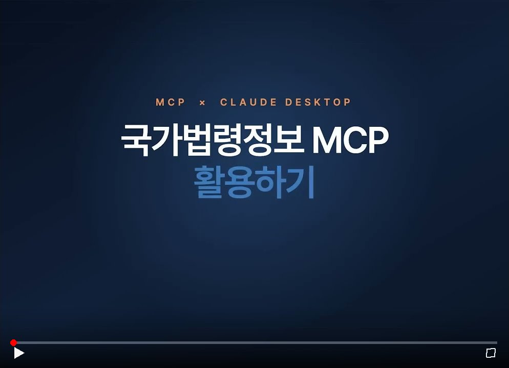
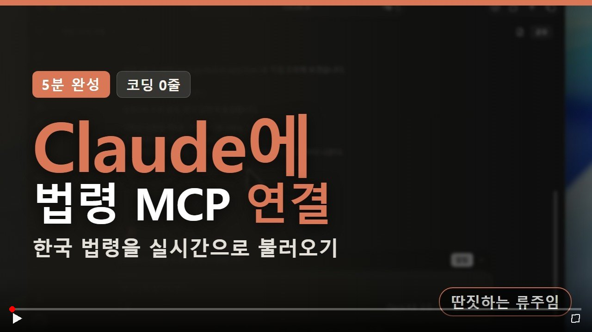
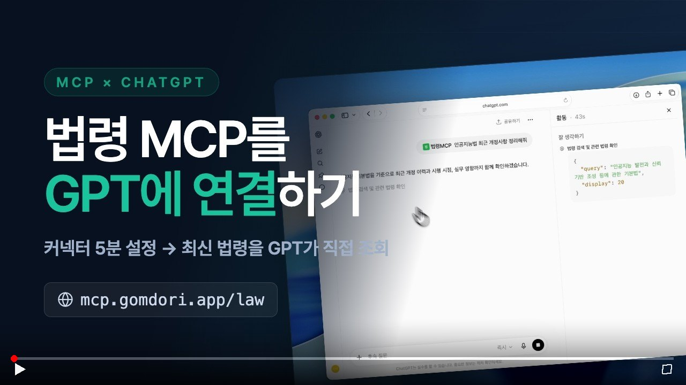

# Korean Law MCP

**42 APIs compressed into 10 tools.** Search and retrieve Korean statutes, precedents, administrative rules, ordinances, treaties and legal interpretations (including the National Tax Service) from your AI assistant or terminal, and **check the legal citations in AI answers against the original text**.

[](https://www.npmjs.com/package/korean-law-mcp)
[](https://www.npmjs.com/package/korean-law-mcp)
[](https://github.com/chrisryugj/korean-law-mcp/stargazers)
[](https://modelcontextprotocol.io)
[](LICENSE)
[](https://www.typescriptlang.org/)
[](https://registry.modelcontextprotocol.io/v0/servers?search=io.github.chrisryugj/korean-law-mcp)

<a href="https://jocohunt.com/p/5lkkxp3x" target="_blank" rel="noopener" title="조코헌트 주간 1등 Top 1 위너">
  
</a>

MCP server and CLI for Korea's official legal database (법제처 Open API). Works with Claude.ai, Claude Desktop, Claude Code, ChatGPT, Cursor, Windsurf, Zed and any MCP-compatible client.

[한국어](./README.md)

> **Legacy endpoint shutdown (2026-11-23)** The remote server moved to a public cloud in Korea. `https://korean-law-mcp.fly.dev/mcp` stops on **2026-11-23**. Please re-register your connector or config with `https://mcp.gomdori.app/law` (keep your own key as `?oc=YOUR_KEY`). Tools and usage are unchanged.

- ⚖️ **Straight from the official source**: statutes, precedents, administrative rules, ordinances, treaties and interpretations, with **23 decision domains**, all fetched from 법제처. Past versions of a law and the successors of repealed statutes are covered too.
- ✅ **Citation check for AI answers**: verifies that the articles and case numbers in an answer exist and that their titles match the 법제처 database. [Actual output](#verification-and-analysis)
- 📈 **About 1.65 million requests a day on the hosted server**: `mcp.gomdori.app` (all five MCP servers combined, measured over 9 days from 2026-11-02 to 11-10, connection requests included). Korean Law MCP accounts for about 85% (October 2026 sample).

If this saves you time, a GitHub ⭐ helps others find it.

[](https://youtu.be/gmkuOqIV3dc)

<sub>▶ Click to play on YouTube. Narration is in Korean.</sub>

| Connect to Claude | Connect to ChatGPT |
|:---:|:---:|
| [](https://youtu.be/KaUKLOH7290) | [](https://youtu.be/-qMk-ajW-GQ) |

**Contents**: [Quick Start](#quick-start) · [Usage Examples](#usage-examples) · [Tool Structure](#tool-structure-10-tools) · [Hosted server](#hosted-server) · [Recent updates](#recent-updates) · [FAQ](#faq) · [Documentation](#documentation)

---

## Quick Start

Listed on the official MCP Registry: [`io.github.chrisryugj/korean-law-mcp`](https://registry.modelcontextprotocol.io/v0/servers?search=io.github.chrisryugj/korean-law-mcp)

| Where | How | Install |
|-------|-----|---------|
| Claude.ai on the web | Add `https://mcp.gomdori.app/law?oc=YOUR_KEY` as a connector ([Option 2](#option-2-claudeai-on-the-web-no-install)) | None |
| Claude Code | Two plugin commands ([Option 1](#option-1-claude-code-plugin-easiest)) | None |
| VS Code, Cursor | Buttons below | None |
| ChatGPT | Plugins › Add › Custom MCP server ([Option 3](#option-3-desktop-apps-remote-server-no-install), [video](https://youtu.be/-qMk-ajW-GQ)) | None |
| Claude Desktop, Windsurf, Zed, Continue | Add the URL to the config file ([Option 3](#option-3-desktop-apps-remote-server-no-install)) | Node.js for Claude Desktop only |
| Your own machine (no hosted server) | `npx korean-law-mcp setup` ([Option 4](#option-4-local-install)) | Node.js 20.19+ |
| Terminal | `korean-law "민법 제1조"` ([Option 5](#option-5-cli)) | Node.js 20.19+ |

[](https://insiders.vscode.dev/redirect/mcp/install?name=korean-law&config=%7B%22type%22%3A%22http%22%2C%22url%22%3A%22https%3A%2F%2Fmcp.gomdori.app%2Flaw%22%7D) [](https://cursor.com/en/install-mcp?name=korean-law&config=eyJ1cmwiOiJodHRwczovL21jcC5nb21kb3JpLmFwcC9sYXcifQ%3D%3D)

<sub>The VS Code and Cursor buttons connect without a key on a shared quota. Add `?oc=YOUR_KEY` to the URL to use your own.</sub>

### Step 0: Get an API key (free, 1 minute)

This is the **법제처 Open API key (OC)**. Options that use the hosted server (1 to 3) also work without one on a shared quota; local installs (Options 4 and 5) need it.

Go to the [법제처 Open API page](https://open.law.go.kr/LSO/openApi/guideList.do) → sign up and log in → **"Open API 사용 신청"** (apply) → fill in the form and you get a key (e.g. `honggildong`). Use that key in the configs below.

### Option 1: Claude Code plugin (easiest)

If you use [Claude Code](https://claude.com/claude-code), two lines are enough. The plugin asks for your API key during install and stores it as sensitive data; leave it empty to use the shared quota.

```
/plugin marketplace add chrisryugj/korean-law-mcp
/plugin install korean-law@korean-law-marketplace
```

Then ask in natural language (`"근로기준법 제74조 알려줘"`, `"민법 제750조 판례 검증해줘"`) and the `korean-law` tools are called automatically. Update with `/plugin marketplace update korean-law-marketplace`.

> The plugin connects to the hosted server `https://mcp.gomdori.app/law` (nothing is installed on your machine) and sends your key in the `apikey` header. To avoid the hosted server, use [Option 4](#option-4-local-install).

<details>
<summary>If install fails with <code>Permission denied (publickey)</code></summary>

The installer tried to clone over SSH and you have no SSH key registered (common for first-time Git users). Either:

1. **Force HTTPS (simplest, recommended):** run this, then retry `/plugin install`. It is safe to leave in place afterwards (HTTPS clone always works)
   ```bash
   git config --global url."https://github.com/".insteadOf "git@github.com:"
   ```
2. **Create and register an SSH key:** if you plan to use SSH regularly
   ```bash
   ssh-keygen -t ed25519 -C "your-email@example.com"   # press Enter 3 times
   cat ~/.ssh/id_ed25519.pub                            # copy the output
   ```
   Paste the public key into [GitHub → Settings → SSH and GPG keys → New SSH key](https://github.com/settings/keys).

</details>

### Option 2: Claude.ai on the web (no install)

Requires a Claude Pro/Max/Team/Enterprise plan (Free allows only one connector).

1. Log in to [claude.ai](https://claude.ai) → your name at the bottom of the sidebar → **Settings** → **Connectors**
2. **Add custom connector** → name `korean-law` (anything works), URL below (replace `honggildong` with your own key from Step 0)

   ```
   https://mcp.gomdori.app/law?oc=honggildong
   ```

3. **Add** → open the connector's **Configure** and set every tool to **Always allow** (important: no approval prompt each time)
4. Ask "근로기준법 제74조 알려줘" in a chat

> To change the connector URL, delete it and add it again. No profile selection needed (10 tools cover all 42 APIs); an existing `?profile=lite&oc=...` URL keeps working.

### Option 3: Desktop apps (remote server, no install)

Add the URL to the app's config file and restart the app.

| Client | Config File |
|--------|------------|
| Claude Desktop | `%APPDATA%\Claude\claude_desktop_config.json` (Win) / `~/Library/Application Support/Claude/claude_desktop_config.json` (Mac) |
| Cursor | `.cursor/mcp.json` |
| Windsurf | `.windsurf/mcp.json` |
| Continue | `~/.continue/config.json` |
| Zed | `~/.config/zed/settings.json` |

**Claude Desktop** does not support remote HTTP MCP servers directly. Use the `mcp-remote` adapter (requires [Node.js](https://nodejs.org) 18+ for `npx`):

```json
{
  "mcpServers": {
    "korean-law": {
      "command": "npx",
      "args": ["-y", "mcp-remote", "https://mcp.gomdori.app/law?oc=your-api-key"]
    }
  }
}
```

**Cursor, Windsurf and other clients with native remote HTTP support** use the URL directly:

```json
{
  "mcpServers": {
    "korean-law": {
      "url": "https://mcp.gomdori.app/law?oc=your-api-key"
    }
  }
}
```

> If other MCP servers are already configured, add only the `"korean-law": { ... }` entry inside `"mcpServers"`.

**ChatGPT**: in the left sidebar open "Plugins" › "Add" › "Create custom MCP server", set the URL to `https://mcp.gomdori.app/law?oc=YOUR_KEY` and authentication to "No authentication". [Connection video](https://youtu.be/-qMk-ajW-GQ) (in Korean)

### Option 4: Local install

Runs on your machine and queries 법제처 directly, without the hosted server. Requires [Node.js](https://nodejs.org) 20.19+ (22.12+ recommended).

**Auto setup (recommended):**

```bash
npx --ignore-scripts --omit=optional korean-law-mcp setup
```

The interactive wizard handles API key input, client selection and config file registration. Supports Claude Desktop, Claude Code, Cursor, VS Code, Windsurf, Gemini CLI, Zed and Antigravity. Project-folder configs (Claude Code `.mcp.json`, VS Code `.vscode/mcp.json`) may be committed to git, so the key is not written in plain text: Claude Code gets a `${LAW_OC}` reference (add `export LAW_OC=your-key` to your shell profile), and VS Code prompts for the key on first run.

**Manual setup:**

```bash
npm install --ignore-scripts --omit=optional -g korean-law-mcp
```

Add this to your MCP client config, then restart the app:

```json
{
  "mcpServers": {
    "korean-law": {
      "command": "korean-law-mcp",
      "env": {
        "LAW_OC": "your-api-key"
      }
    }
  }
}
```

Corporate and air-gapped network settings (HTTP calls, NTS server certificates and proxies), Docker, and the defaults and environment variables for HTTP deployments are in [Self-hosting and corporate networks](docs/SELF-HOSTING-EN.md).

### Option 5: CLI

```bash
npm install --ignore-scripts --omit=optional -g korean-law-mcp
export LAW_OC=your-api-key               # Mac/Linux
set LAW_OC=your-api-key                  # Windows CMD
$env:LAW_OC="your-api-key"              # Windows PowerShell

korean-law "민법 제1조"                  # natural-language query
korean-law search_law --query "관세법"
korean-law get_law_text --mst 160001 --jo "제38조"
korean-law search_precedents --query "부당해고"
korean-law list                          # all tools
korean-law list --category 판례          # filter by category
korean-law help search_law               # tool help
```

### API key delivery (priority order)

| Method | Example | Notes |
|--------|---------|-------|
| URL query | `?oc=your-key` | Simplest for web clients. Applies to the whole session |
| HTTP header | `apikey: your-key` | Also supports `law-oc`, `x-api-key`, `Authorization: Bearer` |
| Environment variable | `LAW_OC=your-key` | Local install (Options 4, 5) |
| Tool parameter | `apiKey: "your-key"` | Per-tool override |

> Without a key, the hosted server falls back to a shared server key under a limit shared by all keyless users. Sending your own key bypasses that limit (free signup: https://open.law.go.kr).

---

## Usage Examples

### Basic lookups

```
User: "관세법 제38조 알려줘"
→ search_law("관세법") → get_law_text(mst, jo="제38조")

User: "화관법 최근 개정 비교"
→ "화관법" → "화학물질관리법" auto-resolved → legal_research(task="amendment_track")

User: "근로기준법 제74조 해석례"
→ search_decisions(domain="interpretation", query="근로기준법 제74조") → get_decision_text(domain="interpretation", id)

User: "산업안전보건법 별표1 내용"
→ get_annexes("산업안전보건법 별표1") → HWPX download → Markdown table
```

Abbreviations are expanded even when combined with other words: `화관법 시행령` → `화학물질관리법 시행령`, `중처법 제4조 책임자` → `중대재해 처벌 등에 관한 법률 제4조 책임자`.

### Natural-language scenarios

Ask in natural language and the matching extra analysis is included automatically. Scenarios are detected from query keywords or set explicitly with the `scenario` parameter.

| Ask this | Get this |
|----------|---------|
| "Food Sanitation Act penalty reduction possible?" | Penalty schedule (1st/2nd/3rd offense) + penalty clauses + appeal cases where penalties were reduced + amendment history |
| "Import customs FTA check" | Customs Act + customs interpretations + FTA treaties + tariff tables + tax tribunal rulings |
| "Building Act permit procedure" | Legal basis (Act → Decree → Rule) + fees/forms + admin rules + local ordinance exceptions + interpretations |
| "Building Act impact analysis" | Subordinate laws + nationwide ordinances affected + related admin rules |
| "National Health Insurance Act delegation" | Delegated provisions whose implementing decrees haven't been created yet |
| "Parking ordinance compliance check" | Constitutional Court decisions + admin appeal cancellations + parent law basis |
| "Labor Standards Act amendment timeline" | Old/new comparison + article history + precedents/interpretations mapped chronologically |

Every result ends with suggested follow-up queries.

### Verification and analysis

| Feature | Ask this | What it does |
|---------|----------|--------------|
| `verify_citations` | Paste an AI-written legal answer | Checks cited articles and precedents against the 법제처 DB: exists ✓ / missing ✗ (with valid range) / wrong title `[CONTENT_MISMATCH]` / repealed `⌛ REPEALED` |
| `cite_check` | "2007다27670 아직 유효해?" | Back-traces later decisions citing the case via full-text search and detects en banc overruling language ("…변경하기로 한다"), a Korean citator |
| `applicable_law` | "2023.5.10 당시 도로교통법 제44조" | Pins the version in force on that date (MST) → the article as it read then → diff with current → transitional provisions from later addenda. Handles former titles and administrative rules (notices) |
| `impact_map` | "민법 제103조 인용한 판례" | Reverse search across precedents, constitutional decisions, interpretations, admin appeals and ordinances + forward citations + a mermaid graph |
| `amendment_table` | Paste the proposed article text | Amendment comparison table (신·구조문대비표): the current text is fetched and compared, changes underlined, unchanged runs `----`, `(생  략)`, `<신  설>`; local runs save a Hangul (.hwpx) file |
| `time_travel` | "개인정보보호법 2020-01-01 vs 2025-11-01" | Article-level diff between two points in time: added (+) / removed (-) / changed (△) |
| `action_plan` | "전세금 못 받았어" | Five steps: situation → rights and remedies → where and by when to file → documents and forms → pitfalls |
| `ordinance_radar` | "광진구 주차장 조례" | Extracts the parent statutes from the ordinance's Article 1 (Purpose), compares their current enforcement dates with the ordinance's, and flags ones to review |

Actual `verify_citations` output:

```
"Housing Lease Protection Act Art. 3-2(2) … Art. 6-3(1) … Art. 7(3) caps increases at 5% … Art. 8(4)"

✓ 주택임대차보호법 제3조의2(보증금의 회수) 제2항 실존            (Art. 3-2(2) exists)
✓ 주택임대차보호법 제6조의3(계약갱신 요구 등) 제1항 실존        (Art. 6-3(1) exists)
✗ 주택임대차보호법 제7조(차임 등의 증감청구권) — [NOT_FOUND] 제3항 없음 (최대 제2항)   (Art. 7 has only 2 paragraphs)
✗ 주택임대차보호법 제8조(보증금 중 일정액의 보호) — [NOT_FOUND] 제4항 없음 (최대 제3항)  (Art. 8 has only 3 paragraphs)
```

### Handy options

| To do this | Call |
|------------|------|
| Read the addenda (effective dates, transitional provisions) | `get_law_text(mst, jo="부칙")` |
| Text as of a given date | `get_law_text(mst, efYd=<date>)`: a non-effective date (today, an incident date) resolves to the version in force that day |
| The annex in force on a date | `get_annexes(lawName, date)` |
| Title + full-text precedent search | `search_decisions(domain="precedent", options={search:"both"})` |
| Part of a long administrative rule | `get_admin_rule` with `jo:"제9-5조"`, `chapter:"제9장"`, `keyword:"해외직접투자"`, or `page:2` |
| Monitor many statutes for changes | `execute_tool(tool_name="search_law_bulk")`: an array of names plus `previous={law_id: previous_MST}` returns only statutes whose MST changed |
| Amendment comparison table | `legal_analysis(mode="amendment_table")`: statute name + proposed article text. For ordinances pass `currentText`; local runs save a Hangul (.hwpx) file with `outputPath` |
| Uncondensed decision text | `get_decision_text(..., full=true)` |

---

## Tool Structure (10 tools)

10 tools are advertised. The former 8 `chain_*` tools are `task` values of `legal_research`, and the 5 analysis features are `mode` values of `legal_analysis`. Other specialized tools stay reachable via `discover_tools` → `execute_tool`, and calling the old tool names directly still works. All advertised tools are read-only.

| Category | Tool | Description |
|----------|------|-------------|
| **Research** (1) | `legal_research` | Multi-step legal research: pick one of 8 `task` values |
| **Analysis** (1) | `legal_analysis` | Verification, analysis and comparison tables: pick one of 5 `mode` values |
| **Law** (3) | `search_law` | Search statutes → get lawId, MST |
| | `get_law_text` | Full article text retrieval (`jo="부칙"` for addenda) |
| | `get_annexes` | Annex/form retrieval (fee tables, rate tables, forms; `date` for the version in force that day) |
| **Ordinance** (1) | `ordinance_radar` | Ordinance revision radar: auto-diffs the parent statutes a local ordinance cites |
| **Unified** (2) | `search_decisions` | **23 domain** unified search (precedents, interpretations, tax tribunal, customs, NTS, MOEL, MOIS interpretations, central-ministry interpretations (39 ministries), constitutional court, admin appeals, FTC, PIPC, NLRC, industrial-accident review, employment-insurance review, ACR, appeal review, ACR special, school rules, public corps, public institutions, treaties, English law) |
| | `get_decision_text` | **23 domain** full text retrieval |
| **Meta** (2) | `discover_tools` | Search specialized tools (terms, annexes, history, comparison, etc.) |
| | `execute_tool` | Execute a discovered specialized tool |

### `legal_research` tasks (formerly chain_*)

| task | Description | Scenario extensions |
|------|-------------|---------------------|
| `full_research` (default) | Full research (AI search → statutes → precedents → interpretations) | `customs`: customs & clearance / `action_plan`: five-step guide |
| `law_system` | Legal hierarchy (three-tier comparison, delegation) | `delegation`: delegated-legislation watch / `impact`: impact analysis |
| `action_basis` | Legal basis for permits and dispositions | `penalty`: dispositions & penalties |
| `dispute_prep` | Dispute preparation (objections, litigation, tribunals) | `domain`: tax/labor/privacy/competition |
| `amendment_track` | Amendment tracking (old/new comparison, history) | `timeline`: chronological timeline / `time_travel`: two-date diff |
| `ordinance_compare` | Ordinance comparison (parent law → ordinances nationwide) | `compliance`: parent-law conformity |
| `procedure_detail` | Procedures, fees and forms | `manual`: civil-servant handling manual |
| `document_review` | Contract / terms risk analysis (`text` required) | none |

### `legal_analysis` modes

| mode | Description | Required |
|------|-------------|----------|
| `verify_citations` | Hallucination guard: cited articles and precedents exist, and article titles match | `text` |
| `cite_check` | Precedent citator: later citations back-traced, overruling detected | `caseNumber` |
| `applicable_law` | Point-in-time law: version in force on a date + transitional provisions; former titles and administrative rules too | `lawName`, `date` |
| `impact_map` | Article impact graph: citing precedents, interpretations, ordinances + mermaid | `lawName`, `jo` |
| `amendment_table` | Amendment comparison table: proposed articles compared with the current text; local runs save a Hangul (.hwpx) file | `lawName`, `amendments` |

Full tool reference: [docs/API.md](docs/API.md).

### Features

- **42 APIs → 10 tools**: statutes, precedents, admin rules, ordinances, constitutional decisions, tax rulings, customs interpretations, NTS interpretations, treaties, institutional rules, legal terminology
- **MCP + CLI**: the same tools from an AI app or your terminal
- **Korean legal handling**: auto-resolves abbreviations (`화관법` → `화학물질관리법`), converts article numbers (`제38조` ↔ `003800`), visualizes 3-tier delegation
- **Currency checks**: `[현행]` / `⚠️[연혁-과거버전]` labels in search results, pending amendments and renames shown alongside, repealed statutes point to the repeal reason and successor regulation
- **Point-in-time across renames**: versions are chained by statute ID, so lookups reach the years before a law was renamed
- **Failures are never reported as "not found"**: lookup failures, maintenance pages and exhausted budgets carry explicit markers such as `[NOT_FOUND]`
- **Annex extraction**: downloads HWPX/HWP/PDF/XLSX/DOCX annexes and converts them to Markdown ([kordoc](https://github.com/chrisryugj/kordoc) engine)
- **8 chains + 9 scenarios**: situation-specific analysis added automatically (penalty reduction, customs clearance, delegated legislation, etc.)
- **Caching**: 1-hour search cache, 24-hour article cache

---

## Hosted server

`https://mcp.gomdori.app/law` is the hosted server you can use without installing anything.

- **Traffic**: about 1.65 million MCP requests a day (all five MCP servers combined, measured over 9 days from 2026-11-02 to 11-10). Request counts include connection requests and differ from user or question counts.
- **Location**: runs on a public cloud in Korea since 2026-11-16. The legacy `korean-law-mcp.fly.dev/mcp` stops on 2026-11-23.
- **Limits**: without a key, requests go through a shared quota (per minute and per day); with your own key, lookups use your own quota.
- **Policies**: [Privacy policy](https://pubax.org/law/privacy/) · [Terms of service](https://pubax.org/law/terms/) (Korean)

---

## Recent updates

Current version **v4.15.23**. All numbers come from the measurements recorded in the [CHANGELOG](CHANGELOG.md).

| Version | What changed | Measured change |
|---------|--------------|-----------------|
| 4.15.23 | Citation check: a paragraph cited on an article that has no numbered paragraphs (e.g. Civil Act Art. 750) is now ✗ instead of ⚠ for "(2)" and above; "(1)" gets a note to cite the article alone | 5 regression tests |
| 4.15.22 | Adds Ministry of the Interior and Safety interpretations `mois` (local-tax rulings) and central-ministry first-line interpretations `ministry` (39 ministries via `options.ministry`) (#182). Local-tax interpretation queries now go to MOIS instead of NTS | Domains 21 → 23 |
| 4.15.21 | Comparison table: deleting a second sentence that opens with "이 경우," shows `<후단 삭제>`; items only renumbered by an insertion read "(현행 제2호와 같음)"; a "(현행과 같음)" range longer than the current text is cut to its last unit (#181) | 3 regression tests |
| 4.15.20 | Comparison table, proposed column: the period after a change that ends right before it no longer turns into 「-」 when a proviso or second sentence is added (#180) | Building Act Art. 79(5) regression test |
| 4.15.19 | Comparison-table HWPX body is left-aligned, so short lines left behind by wrapped dash runs no longer stretch | Checked in Hangul |

Earlier versions: see [CHANGELOG.md](CHANGELOG.md). Milestones:

- **v4.15.16**: amendment comparison tables; on 433 articles from 100 unseen laws, **67.7%** identical to the official tables (3.9% structural mismatch)
- **v4.14.1**: single-article lookup 3.1s → 0.24s (13×); a 15-citation check went from ✓0 to ✓15
- **v4.13.0**: compliance-register monitoring from 98 `search_law` calls → 1–2 `search_law_bulk` calls
- **v4.4.0**: exposed tools 19 → 9, tool-list context ~15.1KB → ~7.2KB (52% smaller)
- **v3.4.0**: precedent / constitutional / admin-appeal responses use 74% fewer tokens on average

---

## Why this exists

South Korea has **1,600+ active laws**, **10,000+ administrative rules**, and a precedent system spanning the Supreme Court, Constitutional Court, tax tribunals and customs rulings. All of it lives on one government site, [법제처](https://www.law.go.kr), which is hard to use from a program.

This project wraps that entire legal system into **10 tools** that any AI assistant or script can call. Built by a Korean civil servant who got tired of manually searching 법제처 for the hundredth time.

## FAQ

**How do I search Korean statutes and court precedents from Claude or ChatGPT?**
Connect this MCP server. In Claude.ai, add `https://mcp.gomdori.app/law?oc=YOUR_KEY` as a custom connector. For other apps see the table in [Quick Start](#quick-start); for ChatGPT see the [connection video](https://youtu.be/-qMk-ajW-GQ) (in Korean).

**Is it free?**
Yes. The code is MIT-licensed, and the 법제처 Open API key it needs is free ([Step 0](#step-0-get-an-api-key-free-1-minute)).

**Can it catch legal citations an LLM made up?**
`legal_analysis(mode="verify_citations")` checks the statute articles and case numbers cited in a text against the official 법제처 source, for existence and for content. `mode="cite_check"` tells whether a precedent is still good law.

**What does it cover?**
Statutes, precedents, administrative rules, local ordinances, treaties and legal interpretations (including the National Tax Service), plus annexes and forms. It also resolves past versions of a law and points repealed statutes to their successors.

## Documentation

- [docs/API.md](docs/API.md): tool reference
- [docs/SELF-HOSTING-EN.md](docs/SELF-HOSTING-EN.md): self-hosting and corporate networks (HTTP calls, certificates and proxies, Docker, environment variables)
- [docs/ARCHITECTURE.md](docs/ARCHITECTURE.md): system design
- [docs/DEVELOPMENT.md](docs/DEVELOPMENT.md): development guide
- [CHANGELOG.md](CHANGELOG.md): release history

## Star History

<a href="https://star-history.dera.page/#chrisryugj/korean-law-mcp&type=timeline&legend=bottom-right">
  <picture>
    <source media="(prefers-color-scheme: dark)" srcset="https://star-history.dera.page/svg?repos=chrisryugj/korean-law-mcp&type=timeline&theme=dark&legend=top-left" />
    <source media="(prefers-color-scheme: light)" srcset="https://star-history.dera.page/svg?repos=chrisryugj/korean-law-mcp&type=timeline&legend=top-left" />
    
  </picture>
</a>

## Data sources

Statute, precedent, administrative-rule, ordinance, treaty and interpretation texts come from the **법제처 National Law Information Center OPEN API** (https://open.law.go.kr/). National Tax Service interpretations use the NTS legal information system.

For any decision that needs legal force, always check the original text at the National Law Information Center. This tool may process and summarize what it retrieves.

Each user must obtain their own API key (`LAW_OC`) from 법제처; a key may be used only by the person it was issued to.

## Credits

- [법제처](https://www.law.go.kr) Open API: Korea's official legal database
- [Anthropic](https://anthropic.com): Model Context Protocol
- [kordoc](https://github.com/chrisryugj/kordoc): HWP/HWPX parser (same author)

## License

[MIT](./LICENSE)

Third-party implementation references and data-source notices: see [NOTICE](./NOTICE).

---

<sub>Made by a Korean civil servant @ 광진구청 AI동호회 AI.Do</sub>
