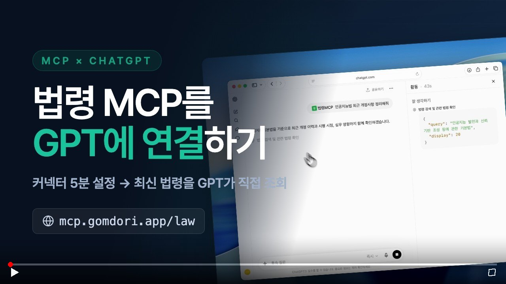

# Korean Law MCP

**법제처 42개 API를 10개 도구로.** 법령·판례·행정규칙·자치법규·조약·해석례(국세청 포함)를 AI 어시스턴트와 터미널에서 조회하고, **AI 답변의 법령 인용을 원문과 대조**합니다.

[](https://www.npmjs.com/package/korean-law-mcp)
[](https://www.npmjs.com/package/korean-law-mcp)
[](https://github.com/chrisryugj/korean-law-mcp/stargazers)
[](https://modelcontextprotocol.io)
[](LICENSE)
[](https://registry.modelcontextprotocol.io/v0/servers?search=io.github.chrisryugj/korean-law-mcp)

<a href="https://jocohunt.com/p/5lkkxp3x" target="_blank" rel="noopener" title="조코헌트 주간 1등 Top 1 위너">
  
</a>

법제처 Open API 기반 MCP 서버와 CLI입니다. Claude.ai·Claude Desktop·Claude Code·ChatGPT·Cursor·Windsurf·Zed 등 MCP를 지원하는 곳에서 씁니다.

[English](./README-EN.md)

> **옛 주소 종료 안내 (2026. 11. 17.)** 원격 서버를 국내 공공 클라우드로 옮겼습니다. `https://korean-law-mcp.fly.dev/mcp` 는 **2026. 11. 17.** 부터 법령을 조회하지 않고 새 주소 안내만 돌려줍니다. 커넥터·설정의 주소를 `https://mcp.gomdori.app/law` 로 바꿔 다시 등록해 주세요(본인 키는 그대로 `?oc=본인키`). 도구와 사용법은 같습니다.

- ⚖️ **법령 원문 그대로**: 법령·판례·행정규칙·자치법규·조약·해석례, 판례류 **23개 도메인**을 법제처 원문에서 조회합니다. 과거 시점 조문과 폐지 법령의 후속 규정까지 찾습니다.
- ✅ **AI 답변 인용 검증**: 답변 속 조문·판례 번호가 실제로 있는지, 제목이 맞는지 법제처 DB와 대조합니다. [실제 결과](#검증분석-기능)
- 📈 **공개 서버 하루 평균 약 165만 건 요청**: `mcp.gomdori.app`(MCP 5종 합계, 2026. 11. 2.~10. 9일 실측, 연결 과정 요청 포함). 그중 법령 MCP가 약 85%(2026. 10. 표본)입니다.

쓸모 있었다면 GitHub ⭐ 하나 눌러주세요. 다른 사람이 이 도구를 찾는 데 도움이 됩니다.

[](https://youtu.be/gmkuOqIV3dc)

<sub>▶ 누르면 유튜브에서 재생됩니다.</sub>

| Claude에 연결하기 | ChatGPT에 연결하기 |
|:---:|:---:|
| [](https://youtu.be/KaUKLOH7290) | [](https://youtu.be/-qMk-ajW-GQ) |

**목차**: [설치 및 사용법](#설치-및-사용법) · [사용 예시](#사용-예시) · [도구 구조](#도구-구조-10개) · [공개 서버](#공개-서버) · [최근 업데이트](#최근-업데이트) · [자주 묻는 질문](#자주-묻는-질문) · [문서](#문서)

---

## 설치 및 사용법

공식 MCP 레지스트리 등록: [`io.github.chrisryugj/korean-law-mcp`](https://registry.modelcontextprotocol.io/v0/servers?search=io.github.chrisryugj/korean-law-mcp)

| 쓰는 곳 | 방법 | 설치 |
|---------|------|------|
| Claude.ai 웹 | 커넥터에 `https://mcp.gomdori.app/law?oc=본인키` 추가 ([방법 2](#방법-2-claudeai-웹에서-바로-사용-설치-없음)) | 없음 |
| Claude Code | 플러그인 명령 두 줄 ([방법 1](#방법-1-claude-code-플러그인-한-줄-설치-가장-쉬움-)) | 없음 |
| VS Code·Cursor | 아래 단추 | 없음 |
| ChatGPT | 플러그인 › 추가 › 맞춤형 MCP 서버 ([방법 3](#방법-3-ai-데스크톱-앱에서-사용-설치-없음) 아래, [영상](https://youtu.be/-qMk-ajW-GQ)) | 없음 |
| Claude Desktop·Windsurf·Zed | 설정 파일에 주소 추가 ([방법 3](#방법-3-ai-데스크톱-앱에서-사용-설치-없음)) | Claude Desktop만 Node.js |
| 내 컴퓨터(서버를 거치지 않음) | `npx korean-law-mcp setup` ([방법 4](#방법-4-내-컴퓨터에-직접-설치-오프라인-가능)) | Node.js 20.19 이상 |
| 터미널 | `korean-law "민법 제1조"` ([방법 5](#방법-5-터미널cli에서-직접-사용)) | Node.js 20.19 이상 |

[](https://insiders.vscode.dev/redirect/mcp/install?name=korean-law&config=%7B%22type%22%3A%22http%22%2C%22url%22%3A%22https%3A%2F%2Fmcp.gomdori.app%2Flaw%22%7D) [](https://cursor.com/en/install-mcp?name=korean-law&config=eyJ1cmwiOiJodHRwczovL21jcC5nb21kb3JpLmFwcC9sYXcifQ%3D%3D)

<sub>VS Code·Cursor 단추는 키 없이 공용 한도로 연결합니다. 본인 키는 주소 끝에 `?oc=본인키`를 붙입니다.</sub>

### 0단계: API 키 발급 (무료, 1분)

**법제처 Open API 인증키(OC)**입니다. 공개 서버를 쓰는 방법(1~3)은 키 없이도 공용 한도로 동작하고, 로컬 설치(방법 4·5)는 키가 꼭 있어야 합니다.

[법제처 Open API 신청 페이지](https://open.law.go.kr/LSO/openApi/guideList.do) 접속 → 회원가입·로그인 → **「Open API 사용 신청」** → 신청서를 쓰면 **인증키(OC)**가 나옵니다(예: `honggildong`). 아래 설정에 이 키를 씁니다.

### 방법 1: Claude Code 플러그인 (한 줄 설치, 가장 쉬움) ⚡

[Claude Code](https://claude.com/claude-code)에서 두 줄이면 됩니다. 설치 중 **법제처 API 키**를 묻습니다(민감정보로 저장, 비워 두면 공용 한도).

```
/plugin marketplace add chrisryugj/korean-law-mcp
/plugin install korean-law@korean-law-marketplace
```

이후 「근로기준법 제74조 알려줘」, 「민법 제750조 판례 검증해줘」처럼 물으면 `korean-law` 도구가 자동으로 불립니다. 새 버전은 `/plugin marketplace update korean-law-marketplace`로 받습니다.

> 플러그인은 공개 서버 `https://mcp.gomdori.app/law`에 연결합니다(내 컴퓨터에 아무것도 설치하지 않음). 키는 `apikey` 헤더로 보냅니다. 서버를 거치지 않으려면 [방법 4](#방법-4-내-컴퓨터에-직접-설치-오프라인-가능)를 쓰세요.

<details>
<summary>설치 중 <code>Permission denied (publickey)</code> 오류가 나면</summary>

설치기가 GitHub에 SSH로 접속했는데 SSH 키가 없는 경우입니다(처음 Git을 쓰는 사람에게 자주 생김). 둘 중 하나로 해결합니다.

1. **HTTPS로 우회 (가장 간단, 추천):** 아래 명령 뒤 다시 `/plugin install`. 그대로 둬도 괜찮습니다(HTTPS clone은 늘 동작)
   ```bash
   git config --global url."https://github.com/".insteadOf "git@github.com:"
   ```
2. **SSH 키 만들어 등록:** SSH를 자주 쓸 예정이라면
   ```bash
   ssh-keygen -t ed25519 -C "your-email@example.com"   # 엔터 3번
   cat ~/.ssh/id_ed25519.pub                            # 출력 복사
   ```
   복사한 공개키를 [GitHub → Settings → SSH and GPG keys → New SSH key](https://github.com/settings/keys)에 붙여 넣습니다.

</details>

### 방법 2: Claude.ai 웹에서 바로 사용 (설치 없음)

주소 하나만 넣으면 됩니다. Claude Pro·Max·Team·Enterprise 요금제가 필요합니다(Free는 커넥터 1개만).

1. [claude.ai](https://claude.ai) 로그인 → 왼쪽 사이드바 아래 **본인 이름** → **설정** → **커넥터**
2. **커스텀 커넥터 추가** → 이름 `korean-law`(아무거나 가능), URL은 아래 주소(`honggildong`을 **본인 인증키**로)

   ```
   https://mcp.gomdori.app/law?oc=honggildong
   ```

3. **추가** → 커넥터 **구성**에서 모든 도구를 **항상 허용**으로 설정(매번 승인할 필요 없음, 중요)
4. 채팅에서 「근로기준법 제74조 알려줘」 입력

> 커넥터 URL을 바꾸려면 지우고 다시 추가합니다. 프로필 선택은 필요 없고(10개 도구가 42개 API 전체를 다룸), 기존 `?profile=lite&oc=...` 주소도 그대로 동작합니다.

### 방법 3: AI 데스크톱 앱에서 사용 (설치 없음)

설정 파일에 주소를 넣고 앱을 다시 시작합니다.

| 앱 | Windows | Mac |
|----|---------|-----|
| Claude Desktop | `%APPDATA%\Claude\claude_desktop_config.json` | `~/Library/Application Support/Claude/claude_desktop_config.json` |
| Cursor | 프로젝트 폴더 안 `.cursor/mcp.json` | 프로젝트 폴더 안 `.cursor/mcp.json` |
| Windsurf | 프로젝트 폴더 안 `.windsurf/mcp.json` | 프로젝트 폴더 안 `.windsurf/mcp.json` |
| Zed | `~/.config/zed/settings.json` | `~/.config/zed/settings.json` |

**Claude Desktop**은 원격 HTTP MCP 서버를 바로 연결하지 못해 `mcp-remote` 어댑터를 거칩니다([Node.js](https://nodejs.org) 18 이상, `npx`용).

```json
{
  "mcpServers": {
    "korean-law": {
      "command": "npx",
      "args": ["-y", "mcp-remote", "https://mcp.gomdori.app/law?oc=honggildong"]
    }
  }
}
```

**Cursor·Windsurf 등 원격 HTTP를 지원하는 앱**은 주소를 바로 씁니다.

```json
{
  "mcpServers": {
    "korean-law": {
      "url": "https://mcp.gomdori.app/law?oc=honggildong"
    }
  }
}
```

> 다른 MCP 서버가 이미 있으면 `"mcpServers": { ... }` 안에 `"korean-law": { ... }` 부분만 더합니다.

**ChatGPT**는 왼쪽 「플러그인」 › 「추가」 › 「맞춤형 MCP 서버 만들기」에서 연결 주소 `https://mcp.gomdori.app/law?oc=본인키`, 인증 「인증 없음」으로 만듭니다. [연결 영상](https://youtu.be/-qMk-ajW-GQ)

### 방법 4: 내 컴퓨터에 직접 설치 (오프라인 가능)

공개 서버를 거치지 않고 내 컴퓨터에서 법제처로 바로 조회합니다. [Node.js](https://nodejs.org) 20.19 이상(22.12 이상 권장)이 필요합니다.

**자동 설치 (추천):**

```bash
npx --ignore-scripts --omit=optional korean-law-mcp setup
```

설치 마법사가 API 키 입력, AI 클라이언트 선택, 설정 파일 등록을 차례로 처리합니다. Claude Desktop, Claude Code, Cursor, VS Code, Windsurf, Gemini CLI, Zed, Antigravity를 지원합니다. 현재 폴더에 쓰는 설정(Claude Code `.mcp.json`, VS Code `.vscode/mcp.json`)은 git에 커밋될 수 있어 키를 평문으로 넣지 않습니다. Claude Code는 `${LAW_OC}` 참조를 넣으니 셸 설정에 `export LAW_OC=발급받은키`를 추가하고, VS Code는 처음 실행할 때 키를 묻습니다.

**수동 설치:**

```bash
npm install --ignore-scripts --omit=optional -g korean-law-mcp
```

AI 앱 설정 파일에 아래 내용을 넣고(`honggildong`을 본인 인증키로) 앱을 다시 시작합니다.

```json
{
  "mcpServers": {
    "korean-law": {
      "command": "korean-law-mcp",
      "env": {
        "LAW_OC": "honggildong"
      }
    }
  }
}
```

사내망·폐쇄망 설정(HTTP 호출, 국세청 서버 인증서·프록시), Docker, 서버로 공개할 때의 기본값과 환경 변수는 [직접 운영·사내망 설정](docs/SELF-HOSTING.md)에 있습니다.

### 방법 5: 터미널(CLI)에서 직접 사용

```bash
# 설치
npm install --ignore-scripts --omit=optional -g korean-law-mcp

# 인증키 설정 (honggildong을 본인 키로)
export LAW_OC=honggildong        # Mac/Linux
set LAW_OC=honggildong           # Windows CMD
$env:LAW_OC="honggildong"       # Windows PowerShell

# 사용 예시
korean-law "민법 제1조"                    # 자연어로 바로 조회
korean-law search_law --query "관세법"     # 도구 직접 호출
korean-law list                            # 전체 도구 목록
korean-law list --category 판례            # 카테고리별 필터
korean-law help search_law                 # 도구별 도움말
```

### API 키 전달 방법 정리

위에서부터 먼저 적용합니다.

| 방법 | 사용법 | 언제 쓰나 |
|------|--------|-----------|
| URL에 포함 | 주소 끝에 `?oc=내키` | 웹 클라이언트에서 가장 간편 |
| HTTP 헤더 | `apikey: 내키` (`law-oc`·`x-api-key`·`Authorization: Bearer`도 받음) | 프로그램으로 연동할 때 |
| 환경 변수 | `LAW_OC=내키` | 로컬 설치(방법 4·5) |
| 도구 파라미터 | `apiKey: "내키"` | 특정 요청만 다른 키를 쓸 때 |

> 키 없이 공개 서버를 쓰면 키 없는 사용자 전원이 나눠 쓰는 서버 키 한도를 거칩니다. 자체 키를 넘기면 이 한도와 상관없습니다(무료 발급: https://open.law.go.kr).

---

## 사용 예시

### 기본 조회

```
"관세법 제38조 알려줘"
→ search_law("관세법") → MST 획득 → get_law_text(mst, jo="제38조")

"화관법 최근 개정 비교"
→ "화관법" → "화학물질관리법" 자동 변환 → legal_research(task="amendment_track")

"근로기준법 제74조 해석례"
→ search_decisions(domain="interpretation", query="근로기준법 제74조") → get_decision_text(domain="interpretation", id)

"산업안전보건법 별표1 내용 알려줘"
→ get_annexes(lawName="산업안전보건법 별표1") → HWPX 파일 받기 → 표·글 Markdown 변환
```

약칭이 다른 말과 붙어도 풀어서 검색합니다: `화관법 시행령` → `화학물질관리법 시행령`, `중처법 제4조 책임자` → `중대재해 처벌 등에 관한 법률 제4조 책임자`.

### 자연어로 복합 분석 (시나리오)

자연어로 물으면 질문에 맞는 추가 분석을 자동으로 함께 보여 줍니다. 시나리오는 질문의 낱말에서 자동으로 찾거나 `scenario` 파라미터로 지정합니다.

| 이렇게 물으면 | 이런 결과 |
|---------------|-----------|
| 「식품위생법 영업정지 과태료 감경 가능?」 | 처분 기준표(1·2·3차 금액) + 벌칙 조항 + 감경된 행정심판 사례 + 개정 이력 |
| 「수입 통관 FTA 적용 확인」 | 관세법 + 관세청 유권해석 + FTA 조약 원문 + 세율 별표 + 조세심판원 판결 |
| 「건축법 허가 절차」 | 법률 → 시행령 → 시행규칙 근거 + 수수료·서식 + 훈령·예규·고시 + 조례 특칙 + 유권해석 |
| 「건축법 영향도 분석」 | 하위법령 + 영향받는 전국 자치법규 + 관련 행정규칙 |
| 「국민건강보험법 위임입법」 | 「시행령으로 정한다」 조항 중 아직 시행령이 없는 것 |
| 「주차 조례 상위법 적합성」 | 헌재 위헌 결정 + 행정심판 취소 사례 + 상위법 근거 대조 |
| 「근로기준법 개정이력 타임라인」 | 신구대조표 + 조문별 개정 이력 + 판례·해석례 시간순 정리 |

모든 결과 끝에 **이어서 할 수 있는 조회**를 제안합니다.

### 검증·분석 기능

| 기능 | 이렇게 물으면 | 하는 일 |
|------|---------------|---------|
| `verify_citations` | AI가 쓴 법률 답변 붙여 넣기 | 인용 조문·판례를 법제처 DB와 대조: 실존 ✓ / 없음 ✗(존재 범위 제시) / 제목 불일치 `[CONTENT_MISMATCH]` / 폐지 `⌛ REPEALED` |
| `cite_check` | 「2007다27670 아직 유효해?」 | 그 사건번호를 인용한 후속 판례를 본문 검색으로 거슬러 찾고, 전원합의체의 변경·폐기 선언(「…변경하기로 한다」)을 감지 |
| `applicable_law` | 「2023.5.10 당시 도로교통법 제44조」 | 기준일 시행 버전(MST) 특정 → 그 시점 조문 → 현행 비교 → 이후 개정 부칙의 적용례·경과조치 발췌. 옛 법령명·고시도 처리 |
| `impact_map` | 「민법 제103조 인용한 판례」 | 판례·헌재·해석례·행정심판·자치법규 역방향 탐색 + 인용 법령 정방향 + mermaid 그래프 |
| `amendment_table` | 개정할 조문 전문 붙여 넣기 | 신·구조문대비표: 현행을 자동으로 대조해 바뀐 곳 밑줄, 같은 부분 `----`, `(생  략)`·`<신  설>`. 로컬 실행은 한글(.hwpx) 저장 |
| `time_travel` | 「개인정보보호법 2020-01-01 vs 2025-11-01」 | 두 시점 본문을 조문 단위로 비교: 추가(+)·삭제(-)·변경(△) |
| `action_plan` | 「전세금 못 받았어」 | 상황 진단 → 권리·구제수단 → 신청기관·기한 → 필요서류·양식 → 주의할 점, 5단계 안내 |
| `ordinance_radar` | 「광진구 주차장 조례」 | 조례 제1조(목적)에서 근거 상위법을 찾아 상위법 현행 시행일과 조례 시행일을 대조하고 정비 검토 대상 표시 |

`verify_citations` 실제 결과 예시:

```
"주택임대차보호법 제3조의2 제2항 … 같은 법 제6조의3 제1항 … 제7조 제3항에 따라 5%를 넘지 못하고 … 제8조 제4항"

✓ 주택임대차보호법 제3조의2(보증금의 회수) 제2항 실존
✓ 주택임대차보호법 제6조의3(계약갱신 요구 등) 제1항 실존
✗ 주택임대차보호법 제7조(차임 등의 증감청구권) — [NOT_FOUND] 제3항 없음 (최대 제2항)
✗ 주택임대차보호법 제8조(보증금 중 일정액의 보호) — [NOT_FOUND] 제4항 없음 (최대 제3항)
```

### 자주 쓰는 옵션

| 하고 싶은 일 | 호출 |
|--------------|------|
| 부칙(시행일·경과조치) 보기 | `get_law_text(mst, jo="부칙")` |
| 특정 날짜 기준 본문 | `get_law_text(mst, efYd=기준일)`: 시행일이 아닌 날짜(오늘·사건일)도 그날 시행 버전으로 보정 |
| 그날 시행 중이던 별표 | `get_annexes(lawName, date)` |
| 판례명·본문 검색 함께 | `search_decisions(domain="precedent", options={search:"both"})` |
| 긴 행정규칙의 일부만 | `get_admin_rule`의 `jo:"제9-5조"`·`chapter:"제9장"`·`keyword:"해외직접투자"`·`page:2` |
| 법령 여러 건 변경 감시 | `execute_tool(tool_name="search_law_bulk")`: 법령명 배열 + `previous={법령ID: 직전 MST}`이면 MST가 바뀐 법령만 반환 |
| 개정안 신·구조문대비표 | `legal_analysis(mode="amendment_table")`: 법령명 + 개정 조문 전문. 조례는 `currentText`, 로컬 실행은 `outputPath`로 한글(.hwpx) 저장 |
| 판례 전문(축약 해제) | `get_decision_text(..., full=true)` |

---

## 도구 구조 (10개)

노출 도구는 10개입니다. `chain_*` 8개는 `legal_research`의 `task`로, 분석 기능 5개는 `legal_analysis`의 `mode`로 묶었습니다. 나머지 전문 도구는 `discover_tools` → `execute_tool`로 쓰며, 기존 도구명 직접 호출도 하위 호환으로 동작합니다. 모든 노출 도구는 조회 전용입니다.

| 구분 | 도구 | 설명 |
|------|------|------|
| **리서치** (1) | `legal_research` | 다단계 법령 리서치: `task` 8종 (아래 표) |
| **정밀분석** (1) | `legal_analysis` | 검증·분석·대비표: `mode` 5종 (아래 표) |
| **법령** (3) | `search_law` | 법령 검색 → lawId, MST 획득 |
| | `get_law_text` | 조문 전문 조회(`jo="부칙"`으로 부칙) |
| | `get_annexes` | 별표·서식 조회(금액표·요율표·별지서식, `date`로 그날 시행 버전의 별표) |
| **자치법규** (1) | `ordinance_radar` | 조례 정비 레이더: 근거 상위법 개정 자동 대조 |
| **통합** (2) | `search_decisions` | **23개 도메인** 통합 검색(판례·헌재·조세심판·관세·국세청·고용노동부·행정안전부 해석·중앙부처 1차 해석(39개 부처)·공정위·노동위·산재보험재심사·고용보험심사·해석례·행심·개인정보위·권익위·소청심사·학칙·공사공단·공공기관·조약·영문법령) |
| | `get_decision_text` | **23개 도메인** 전문 조회 |
| **메타** (2) | `discover_tools` | 전문 도구 검색(용어·별표·이력·비교 등) |
| | `execute_tool` | 전문 도구 실행 |

### `legal_research` task 8종 (옛 chain_*)

| task | 설명 | 시나리오 확장 |
|------|------|-------------|
| `full_research` (기본) | 종합 리서치(AI 검색 → 법령 → 판례 → 해석) | `customs`: 관세·통관 종합 / `action_plan`: 5단계 안내 |
| `law_system` | 법체계 분석(3단 비교, 위임 구조) | `delegation`: 위임입법 감시 / `impact`: 영향도 분석 |
| `action_basis` | 처분 근거 확인(허가·인가·처분) | `penalty`: 처분·벌칙 기준 종합 |
| `dispute_prep` | 쟁송 대비(불복·소송·심판) | `domain`: tax/labor/privacy/competition |
| `amendment_track` | 개정 추적(신구 대조, 연혁) | `timeline`: 시계열 타임라인 / `time_travel`: 두 시점 자동 비교 |
| `ordinance_compare` | 조례 비교(상위법 → 전국 조례) | `compliance`: 상위법 적합성 검증 |
| `procedure_detail` | 절차·비용·서식 안내 | `manual`: 공무원 처리 매뉴얼 |
| `document_review` | 계약서·약관 리스크 분석(`text` 필수) | 없음 |

### `legal_analysis` mode 5종

| mode | 설명 | 필수 파라미터 |
|------|------|-------------|
| `verify_citations` | LLM 환각 방지: 인용 조문·판례 실존과 조문 제목 일치 검증 | `text` |
| `cite_check` | 판례 생사 확인: 후속 인용 역추적 + 변경·폐기 감지(한국형 Citator) | `caseNumber` |
| `applicable_law` | 행위시법 판단: 시점 적용 버전 + 부칙 경과규정 발췌. 옛 법령명·행정규칙(고시)도 | `lawName`, `date` |
| `impact_map` | 조문 영향 그래프: 인용 판례·해석·자치법규 역방향 탐색 + mermaid | `lawName`, `jo` |
| `amendment_table` | 신·구조문대비표: 개정 조문 → 현행 자동 대조, 로컬 실행은 한글(.hwpx) 저장 | `lawName`, `amendments` |

전체 도구 상세는 [docs/API.md](docs/API.md)에 있습니다.

### 주요 특징

- **42개 API → 10개 도구**: 법령, 판례, 행정규칙, 자치법규, 헌재 결정, 조세심판, 관세 해석, 국세청 해석례, 조약, 학칙·공단·공공기관 규정, 법령용어
- **MCP + CLI**: AI 앱과 터미널에서 같은 도구를 씁니다
- **법률 도메인 처리**: 약칭 자동 인식(`화관법` → `화학물질관리법`), 조문 번호 변환(`제38조` ↔ `003800`), 3단 위임 구조 시각화
- **현행성 안내**: 검색 결과에 `[현행]`/`⚠️[연혁-과거버전]` 표시, 시행예정 개정·제명 변경을 함께 보여 주고, 폐지 법령은 폐지 사유와 후속 통합 규정을 안내
- **과거 시점 그대로**: 법령ID로 버전을 이어 법령명이 바뀌기 전 시절까지 조회
- **실패를 「없음」으로 답하지 않음**: 조회 실패·점검 페이지·예산 초과는 `[NOT_FOUND]` 등 명시 표시로 구분
- **별표·별지서식 본문 추출**: HWPX·HWP·PDF·XLSX·DOCX를 자동 변환([kordoc](https://github.com/chrisryugj/kordoc) 엔진)
- **8개 체인 + 9개 시나리오**: 기본 체인에 상황별 확장 분석 자동 추가(과태료 감경, 관세 통관, 위임입법 감시 등)
- **캐시**: 검색 1시간, 조문 24시간

---

## 공개 서버

`https://mcp.gomdori.app/law`는 설치 없이 쓰는 공개 서버입니다.

- **이용량**: 하루 평균 약 165만 건의 MCP 요청(MCP 5종 합계, 2026. 11. 2.~10. 9일 실측). 요청 수는 연결 과정 요청을 포함하며 이용자 수나 질문 수와 다릅니다.
- **위치**: 2026. 11. 16.부터 국내 공공 클라우드에서 동작합니다. 옛 주소 `korean-law-mcp.fly.dev/mcp`는 2026. 11. 17.부터 새 주소 안내만 돌려줍니다.
- **한도**: 키 없이 쓰면 공용 한도(분당·하루)를 거치고, 본인 키를 넣으면 본인 한도로 조회합니다.
- **정책**: [개인정보처리방침](https://pubax.org/law/privacy/) · [이용약관](https://pubax.org/law/terms/)

---

## 최근 업데이트

현재 버전 **v4.15.34**. 수치는 모두 [CHANGELOG](CHANGELOG.md)의 실측 기록에서 옮겼습니다.

| 버전 | 바뀐 점 | 변화 |
|------|---------|------|
| 4.15.31 | 법제처 law-mcp와 인자·동작까지 다시 맞대 고쳤습니다. 판례 기간 필터가 실제로 걸리고, 인용 검증이 삭제 조문과 틀린 형량·금액을 잡고, 3단 비교·신구 대비를 조 단위로 고르고, 조례 정비 레이더가 조례 조가 인용한 근거법 조를 하나씩 대조합니다. 본문 검색·법령 안 조문 검색·시행예정 변경·위임 조례·조례와 근거법 대조·용어 풀이 도구를 더했습니다 | 손해배상·대법원·2015년 판례 0 → **98**건 · 형법 제241조(삭제) ✓실존 → **✗삭제** · 3단 비교 볼 수 있는 조 5 → **전부** · 도구 104 → **110** · 시험 1,526개 |
| 4.15.30 | 찾기 쉬운 생활법령정보 Open API를 직접 연결했습니다. 생활법령 검색이 판례·행정심판·해석례·생활조례까지 10분류를 내고, 백문백답 답변·해설 전문(`get_life_law`), 지자체 생활조례(`region`), 외국어판(`lang`)을 봅니다 | 「출산」+연천군 → 출산장려금 해설 · 영어 생활법령 35건 · 시험 15건 |
| 4.15.29 | 의존 패키지 `hono`·`@hono/node-server` 보안 권고(moderate 6건)를 반영해 판을 올렸습니다 | `npm audit` 0건 · 릴리스 검증 워크플로 통과 |
| 4.15.28 | 벌칙 조회 `get_penalties`(의무 조문 → 벌칙 항·호 → 시행령 부과기준 별표의 금액 행), 법령체계도의 지자체 조례 거르기(`region`), 일상 질문의 쟁점어 `terms` 를 더했습니다. 「…받는 방법」이 진폐법을 고르던 검색 오류를 고쳤습니다 | 근로기준법 제48조 → 별표 7 「임금명세서 미교부 30·50·100만원」 · 주차장법 광진구 조례 2건 · 시험 1,491건 |
| 4.15.27 | 법령 기본정보 카드 `get_law_info`(업무별 담당부서·전화번호, 조문별 시행일, 제개정이유, 시행예정)를 더했습니다. 체인이 법령명 없는 일상 질문에서 엉뚱한 법령(임금명세서 과태료 → 아동·청소년성보호법)을 고르던 것을 고쳤습니다 | 일상 질문 32개 기반 법령 정답 22 → **26**, 나빠짐 0 · 시험 1,475건 |
| 4.15.26 | 생활법령 해설 검색 `search_life_law`를 더했습니다. 법제처가 공개한 생활법령 MCP를 불러 찾기 쉬운 생활법령정보의 백문백답·관심규정해설·관련 판례 발췌와 원문 링크를 냅니다(인증키 없음) | 시험 6건 · 실제 질문 「월급을 못 받았는데…」에서 백문백답·판례 확인 |

이전 버전 전체 내역은 [CHANGELOG.md](CHANGELOG.md)에 있습니다. 대표 이정표:

- **v4.15.16**: 신·구조문대비표 작성, 처음 보는 100개 법령 433조문에서 공식 대비표와 완전 일치 **67.7%**(구조 불일치 3.9%)
- **v4.14.1**: 조문 1개 조회 3.1초 → 0.24초(13배), 인용 15건 검증 ✓0 → ✓15
- **v4.13.0**: 준법 등록부 감시 `search_law` 98회 호출 → `search_law_bulk` 1~2회
- **v4.4.0**: 노출 도구 19개 → 9개, 도구 목록 컨텍스트 약 15.1KB → 약 7.2KB(52% 감축)
- **v3.4.0**: 판례·헌재·행심 응답 토큰 평균 74% 감축

---

## 왜 만들었나

대한민국에는 **1,600개 이상의 현행 법률**, **10,000개 이상의 행정규칙**, 그리고 대법원·헌법재판소·조세심판원·관세청까지 이어지는 방대한 판례 체계가 있습니다. 모두 [법제처](https://www.law.go.kr) 한 사이트에 있지만, 프로그램에서 쓰기는 어렵습니다.

이 프로젝트는 그 법령 체계 전체를 **10개 도구**로 감싸 AI 어시스턴트나 스크립트가 바로 부를 수 있게 합니다. 법제처를 수백 번 손으로 검색하다 지친 공무원이 만들었습니다.

## 자주 묻는 질문

**Q. Claude·ChatGPT에서 한국 법령·판례를 검색하려면?**
이 MCP 서버를 연결합니다. Claude.ai는 커넥터 주소 `https://mcp.gomdori.app/law?oc=본인키`를 넣으면 되고, 그 밖의 앱은 [설치 및 사용법](#설치-및-사용법)의 표를 보세요. ChatGPT는 [연결 영상](https://youtu.be/-qMk-ajW-GQ)을 따르면 됩니다.

**Q. 무료인가요?**
MIT 라이선스 오픈소스입니다. 필요한 법제처 Open API 인증키도 무료로 발급됩니다([0단계](#0단계-api-키-발급-무료-1분)).

**Q. AI가 지어낸 조문·판례를 걸러낼 수 있나요?**
`legal_analysis(mode="verify_citations")`가 답변 속 법령 조문과 판례 번호를 법제처 원문과 대조해 실존 여부와 내용 일치를 확인합니다. 판례가 아직 유효한지는 `mode="cite_check"`로 봅니다.

**Q. 어디까지 조회되나요?**
법령, 판례, 행정규칙, 자치법규(조례·규칙), 조약, 법령해석례(국세청 포함)와 별표·서식입니다. 과거 시점 법령과 폐지 법령의 후속 규정도 찾습니다.

## 문서

- [docs/API.md](docs/API.md): 도구 레퍼런스
- [docs/SELF-HOSTING.md](docs/SELF-HOSTING.md): 직접 운영·사내망 설정(HTTP 호출, 인증서·프록시, Docker, 환경 변수)
- [docs/ARCHITECTURE.md](docs/ARCHITECTURE.md): 시스템 설계
- [docs/DEVELOPMENT.md](docs/DEVELOPMENT.md): 개발 가이드
- [CHANGELOG.md](CHANGELOG.md): 버전별 변경 내역

## Star History

<a href="https://star-history.dera.page/#chrisryugj/korean-law-mcp&type=timeline&legend=bottom-right">
  <picture>
    <source media="(prefers-color-scheme: dark)" srcset="https://star-history.dera.page/svg?repos=chrisryugj/korean-law-mcp&type=timeline&theme=dark&legend=top-left" />
    <source media="(prefers-color-scheme: light)" srcset="https://star-history.dera.page/svg?repos=chrisryugj/korean-law-mcp&type=timeline&legend=top-left" />
    
  </picture>
</a>

## 데이터 출처

법령·판례·행정규칙·자치법규·조약·해석례 본문은 **법제처 국가법령정보센터 OPEN API**(https://open.law.go.kr/)에서 조회합니다. 국세청 해석례는 국세법령정보시스템을 씁니다.

법적 효력이 필요한 판단에는 반드시 국가법령정보센터 원문을 확인하세요. 이 도구는 조회 결과를 가공·요약할 수 있습니다.

API 인증키(`LAW_OC`)는 법제처에서 **각자 발급**받아야 하며, 발급받은 본인만 쓸 수 있습니다.

## 라이선스

[MIT](./LICENSE)

제3자 구현 참조 및 데이터 출처 고지는 [NOTICE](./NOTICE)를 참조하세요.

---

<sub>Made by 류주임 @ 광진구청 AI동호회 AI.Do</sub>
