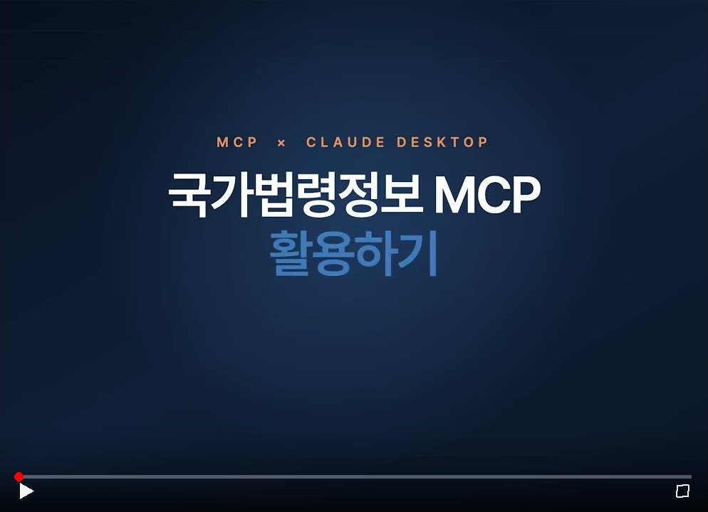
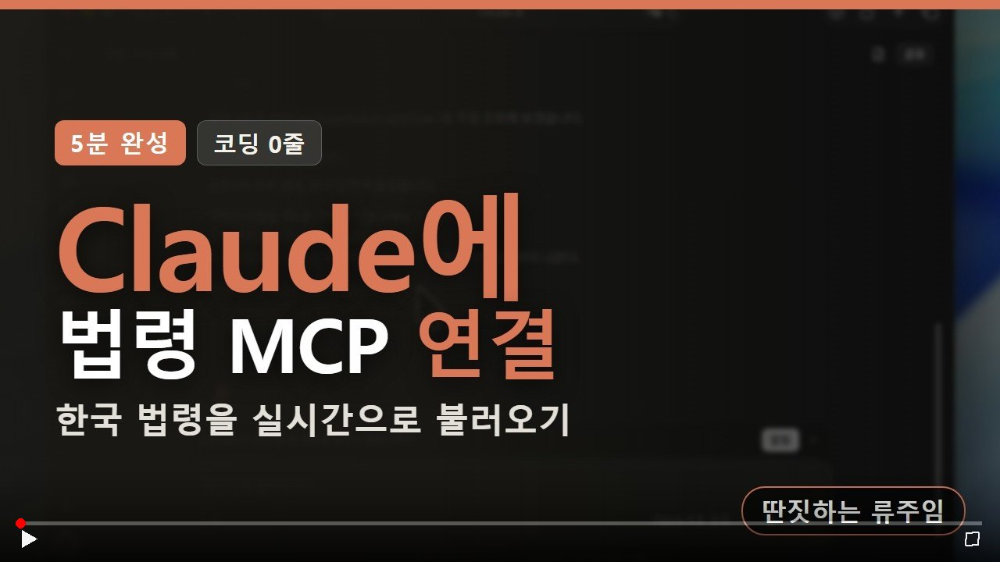
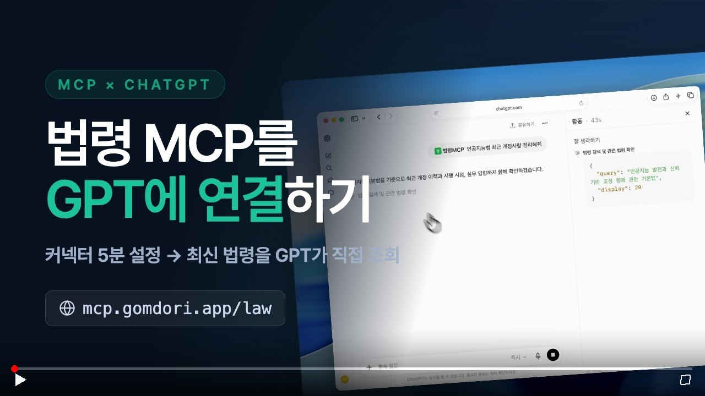

# Korean Law MCP

**법제처 42개 API를 10개 도구로.** 법령·판례·행정규칙·자치법규·조약·해석례(국세청 포함) 조회와 **AI 답변의 인용 검증**을 AI 어시스턴트나 터미널에서 바로 사용.

[](https://www.npmjs.com/package/korean-law-mcp)
[](https://modelcontextprotocol.io)
[](LICENSE)
[](https://registry.modelcontextprotocol.io/v0/servers?search=io.github.chrisryugj/korean-law-mcp)

<a href="https://jocohunt.com/p/5lkkxp3x" target="_blank" rel="noopener" title="조코헌트 주간 1등 Top 1 위너">
  
</a>

> 법제처 Open API 기반 MCP 서버 + CLI. Claude Desktop, Cursor, Windsurf, Zed, Claude.ai 등에서 바로 사용 가능.

[English](./README-EN.md)

**바로 쓰기:** Claude.ai 커넥터에 `https://mcp.gomdori.app/law?oc=본인키` 한 줄, Claude Code는 플러그인 두 줄 → [설치 및 사용법](#설치-및-사용법)

VS Code·Cursor는 버튼 한 번으로 연결됩니다(키 없이 공용 한도로 동작, 본인 키는 주소 끝에 `?oc=본인키`).

[](https://insiders.vscode.dev/redirect/mcp/install?name=korean-law&config=%7B%22type%22%3A%22http%22%2C%22url%22%3A%22https%3A%2F%2Fmcp.gomdori.app%2Flaw%22%7D) [](https://cursor.com/en/install-mcp?name=korean-law&config=eyJ1cmwiOiJodHRwczovL21jcC5nb21kb3JpLmFwcC9sYXcifQ%3D%3D)

쓸모 있었다면 GitHub ⭐ 하나 눌러주세요. 다른 사람이 이 도구를 찾는 데 도움이 됩니다.

[](https://youtu.be/gmkuOqIV3dc)

<sub>▶ 클릭하면 유튜브에서 재생됩니다.</sub>

### AI에 연결하기

| Claude에 연결하기 | ChatGPT에 연결하기 |
|:---:|:---:|
| [](https://youtu.be/KaUKLOH7290) | [](https://youtu.be/-qMk-ajW-GQ) |

---

## 최근 업데이트

현재 버전 **v4.15.19**. 수치는 모두 [CHANGELOG](CHANGELOG.md)의 실측 기록에서 옮김.

| 버전 | 주요 변경 | 변화 |
|------|-----------|------|
| 4.15.19 | 대비표 한글(.hwpx) 본문 왼쪽 정렬 — 줄표가 넘어간 짧은 줄이 벌어지던 것 | 한글 화면 확인 |
| 4.15.18 | `legal_analysis` 설명·제목에 「신구조문대비표」 낱말(claude.ai 도구 검색 0건 수정) | 검색 낱말 게이트 테스트 |
| 4.15.17 | 대비표를 노출 도구 `legal_analysis(mode="amendment_table")`로(시연에서 숨은 도구를 안 찾음), 채팅 표 밑줄은 굵은 글씨 | 노출 도구 10개 유지 |
| 4.15.16 | 신·구조문대비표 작성 `amendment_table`(execute_tool): 개정 조문 → 현행 자동 대조, 밑줄·`----`·`(생  략)`·`<신  설>`, 로컬 실행은 한글(.hwpx) 저장 | 처음 보는 100개 법령 433조문, 공식 대비표와 완전 일치 **67.7%**(구조 불일치 3.9%) |
| 4.15.15 | 별표 파서 kordoc 4.24.25(PDF 표 행·단위 표기 줄 수정 등), `@hono/node-server` 2.1.5 | `npm audit` 1건 → **0건**, 실제 별표 3건 출력 동일 |
| 4.15.14 | 보안: 의존성 취약점 정리 — 하위 kordoc 4.24.8(zod 4), zod 4.6.7, 개발 도구·하위 의존성 수정판 | `npm audit` 10건 → **0건** |
| 4.15.13 | Claude Code 플러그인이 로컬 npx 대신 공개 서버(`mcp.gomdori.app/law`)에 연결, 키는 선택 | 설치 없음 |
| 4.15.12 | 도구 사이 안내(예: 여러 법령 감시는 `search_law_bulk`)를 도구 설명에서 서버 안내문(`instructions`)으로 옮김 | 같은 질문 4개에서 고르는 도구 동일 |
| 4.15.11 | 노출 도구 10개에 사람용 제목(`title`·`annotations.title`) 추가: 클라이언트 승인 창에 "법령 검색"처럼 표시 | 제목 0개 → 10개 |
| 4.15.10 | 국세청 법령해석 본문 조회: 검색 결과의 `본문조회ID(ntstDcmId)`로 `get_decision_text(domain="nts")` — 요지·회신·본문 (#178) | 목록·링크만 → 본문까지 |

이전 버전 전체 내역은 [CHANGELOG.md](CHANGELOG.md) 참조. 대표 이정표:

- **v4.14.1**: 조문 1개 조회 3.1초 → 0.24초(13배), 인용 15건 검증 ✓0 → ✓15
- **v4.13.0**: 준법 등록부 감시 `search_law` 98회 호출 → `search_law_bulk` 1~2회
- **v4.4.0**: 노출 도구 19개 → 9개, 도구 목록 컨텍스트 ~15.1KB → ~7.2KB (52% 감축)
- **v3.4.0**: 판례·헌재·행심 응답 토큰 평균 74% 감축

---

## 왜 만들었나

대한민국에는 **1,600개 이상의 현행 법률**, **10,000개 이상의 행정규칙**, 그리고 대법원·헌법재판소·조세심판원·관세청까지 이어지는 방대한 판례 체계가 있습니다. 이 모든 게 [법제처](https://www.law.go.kr)라는 하나의 사이트에 있지만, 개발자 경험은 최악입니다.

이 프로젝트는 그 전체 법령 시스템을 **10개 도구**로 감싸서, AI 어시스턴트나 스크립트에서 바로 호출할 수 있게 만듭니다. 법제처를 수백 번 수동 검색하다 지친 공무원이 만들었습니다.

---

## 설치 및 사용법

공식 MCP 레지스트리 등재: [`io.github.chrisryugj/korean-law-mcp`](https://registry.modelcontextprotocol.io/v0/servers?search=io.github.chrisryugj/korean-law-mcp)

### 0단계: API 키 발급 (무료, 1분)

**법제처 Open API 인증키(OC)**를 먼저 발급받으세요. 로컬 설치(방법 4·5)는 키가 꼭 있어야 하고, 공개 서버를 쓰는 방법(1~3)은 키 없이도 공용 한도로 동작합니다.

[법제처 Open API 신청 페이지](https://open.law.go.kr/LSO/openApi/guideList.do) 접속 → 회원가입·로그인 → **"Open API 사용 신청"** → 신청서 작성 시 **인증키(OC)** 발급 (예: `honggildong`). 이 인증키를 아래 설정에서 사용.

### 방법 1: Claude Code 플러그인 (한 줄 설치, 가장 쉬움) ⚡

[Claude Code](https://claude.com/claude-code)를 쓴다면 두 줄이면 끝. API 키는 설치 중 자동으로 물어봅니다.

```
/plugin marketplace add chrisryugj/korean-law-mcp
/plugin install korean-law@korean-law-marketplace
```

설치 중 **법제처 API 키**를 묻습니다 (0단계에서 발급받은 `honggildong` 같은 키, 민감정보로 저장). 비워 두면 공용 한도로 동작합니다. 이후 Claude Code에 자연어로 질문하면(`"근로기준법 제74조 알려줘"`, `"민법 제750조 판례 검증해줘"`) `korean-law` MCP 도구가 자동 호출됩니다. 새 버전은 한 줄로 최신화:

```
/plugin marketplace update korean-law-marketplace
```

> 플러그인은 공개 서버 `https://mcp.gomdori.app/law` 에 연결합니다(내 컴퓨터에 아무것도 설치하지 않음). 키는 `apikey` 헤더로 보냅니다. 서버를 거치지 않으려면 [방법 4](#방법-4-내-컴퓨터에-직접-설치-오프라인-가능)의 로컬 설치를 쓰세요.

#### Troubleshooting: `Permission denied (publickey)` 에러

설치 중 `git@github.com: Permission denied (publickey).`가 뜨면 설치기가 GitHub에 SSH로 접속했는데 SSH 키가 없는 경우 (처음 Git을 쓰는 비개발자·법률 실무자에게 자주 발생). 둘 중 하나로 해결:

1. **HTTPS로 강제 우회 (가장 간단, 추천):** 아래 한 줄 실행 후 다시 `/plugin install`. 설치 후에도 그대로 둬도 무방 (HTTPS clone이 항상 동작)
   ```bash
   git config --global url."https://github.com/".insteadOf "git@github.com:"
   ```
2. **SSH 키 생성 후 등록:** SSH를 자주 쓸 예정이라면
   ```bash
   ssh-keygen -t ed25519 -C "your-email@example.com"   # 엔터 3번
   cat ~/.ssh/id_ed25519.pub                            # 출력 복사
   ```
   복사한 공개키를 [GitHub → Settings → SSH and GPG keys → New SSH key](https://github.com/settings/keys)에 붙여넣기

### 방법 2: Claude.ai 웹에서 바로 사용 (설치 없음)

아무것도 설치하지 않고 주소 하나만 입력. Claude Pro/Max/Team/Enterprise 요금제 필요 (Free는 커넥터 1개만 가능).

1. [claude.ai](https://claude.ai) 로그인 → 왼쪽 사이드바 하단 **본인 이름** → **설정**(Settings) → **커넥터**(Connectors)
2. **커스텀 커넥터 추가** → 이름 `korean-law`(아무거나 OK), URL은 아래 주소 (`honggildong`을 **0단계에서 발급받은 본인 인증키**로 교체)

   ```
   https://mcp.gomdori.app/law?oc=honggildong
   ```

3. **추가** → 커넥터 **구성**(Configure)에서 모든 도구를 **항상 사용**(Always allow)으로 설정 (매번 승인 불필요, 중요)
4. 채팅에서 "근로기준법 제74조 알려줘" 입력

> 커넥터 URL을 수정하려면 삭제 후 다시 추가. 프로필 선택 불필요(10개 도구가 42개 API 전체 커버), 기존 `?profile=lite&oc=...` 주소도 그대로 작동.

### 방법 3: AI 데스크톱 앱에서 사용 (설치 없음)

Claude Desktop, Cursor, Windsurf 같은 **데스크톱 앱**을 쓰고 있다면, 설정 파일에 아래 내용을 추가하세요.

**설정 파일 위치 찾기:**

| 앱 이름 | Windows | Mac |
|---------|---------|-----|
| Claude Desktop | `%APPDATA%\Claude\claude_desktop_config.json` | `~/Library/Application Support/Claude/claude_desktop_config.json` |
| Cursor | 프로젝트 폴더 안 `.cursor/mcp.json` | 프로젝트 폴더 안 `.cursor/mcp.json` |
| Windsurf | 프로젝트 폴더 안 `.windsurf/mcp.json` | 프로젝트 폴더 안 `.windsurf/mcp.json` |

#### Claude Desktop

Claude Desktop은 원격 HTTP MCP 서버를 직접 연결하지 못하므로 `mcp-remote` 어댑터를 통해 연결합니다. [Node.js](https://nodejs.org) 18 이상이 필요합니다 (`npx` 사용을 위해).

```json
{
  "mcpServers": {
    "korean-law": {
      "command": "npx",
      "args": [
        "-y",
        "mcp-remote",
        "https://mcp.gomdori.app/law?oc=honggildong"
      ]
    }
  }
}
```

> `honggildong`을 본인 인증키로 바꾸세요. Node.js를 설치하기 싫다면 [방법 4](#방법-4-내-컴퓨터에-직접-설치-오프라인-가능)의 로컬 설치를 사용하세요.

#### Cursor, Windsurf 등 (원격 HTTP 지원 클라이언트)

```json
{
  "mcpServers": {
    "korean-law": {
      "url": "https://mcp.gomdori.app/law?oc=honggildong"
    }
  }
}
```

> 이미 다른 MCP 서버가 설정되어 있다면, `"mcpServers": { ... }` 안에 `"korean-law": { ... }` 부분만 추가하면 됩니다.

저장 후 앱을 **재시작**하면 법령 도구가 활성화됩니다.

### 방법 4: 내 컴퓨터에 직접 설치 (오프라인 가능)

인터넷 없이 쓰고 싶거나, 원격 서버를 거치지 않으려면 직접 설치할 수 있습니다.

**사전 준비:** [Node.js](https://nodejs.org) 20.19 이상이 설치되어 있어야 합니다 (22.12 이상 권장).

**자동 설치 (추천):**

```bash
npx --ignore-scripts --omit=optional korean-law-mcp setup
```

설치 마법사가 API 키 입력 → AI 클라이언트 선택 → 설정 파일 자동 등록까지 한 번에 처리합니다.
Claude Desktop, Claude Code, Cursor, VS Code, Windsurf, Gemini CLI, Zed, Antigravity를 지원합니다.
현재 폴더에 쓰는 설정(Claude Code `.mcp.json`, VS Code `.vscode/mcp.json`)은 git에 커밋될 수 있어 키를 평문으로 넣지 않습니다.
Claude Code는 `${LAW_OC}` 참조를 넣으니 셸 설정에 `export LAW_OC=발급받은키`를 추가하고, VS Code는 처음 실행할 때 키를 묻습니다.

**수동 설치:**

```bash
npm install --ignore-scripts --omit=optional -g korean-law-mcp
```

AI 앱 설정 파일에 아래 내용을 추가합니다 (`honggildong`을 본인 인증키로 바꾸세요):

```json
{
  "mcpServers": {
    "korean-law": {
      "command": "korean-law-mcp",
      "env": {
        "LAW_OC": "honggildong"
      }
    }
  }
}
```

앱을 재시작하면 완료!

### 방법 5: 터미널(CLI)에서 직접 사용

개발자라면 터미널에서 직접 법령을 검색할 수 있습니다.

```bash
# 설치
npm install --ignore-scripts --omit=optional -g korean-law-mcp

# 인증키 설정 (honggildong을 본인 키로 바꾸세요)
export LAW_OC=honggildong        # Mac/Linux
set LAW_OC=honggildong           # Windows CMD
$env:LAW_OC="honggildong"       # Windows PowerShell

# 사용 예시
korean-law "민법 제1조"                    # 자연어로 바로 조회
korean-law search_law --query "관세법"     # 도구 직접 호출
korean-law list                            # 전체 도구 목록
korean-law list --category 판례            # 카테고리별 필터
korean-law help search_law                 # 도구별 도움말
```

### API 키 전달 방법 정리

여러 방법으로 인증키를 전달할 수 있습니다. 위에서부터 우선 적용됩니다:

| 방법 | 사용법 | 언제 쓰나 |
|------|--------|-----------|
| URL에 포함 | 주소 끝에 `?oc=내키` | 웹 클라이언트에서 가장 간편 |
| HTTP 헤더 | `apikey: 내키` | 프로그래밍으로 연동할 때 |
| 환경변수 | `LAW_OC=내키` | 로컬 설치(방법 4, 5) |
| 도구 파라미터 | `apiKey: "내키"` | 특정 요청만 다른 키 쓸 때 |

> 키 없이 공개 서버(`mcp.gomdori.app/law`)를 쓰면 무키 사용자 전원이 공유하는 서버 키 한도를 거침. 자체 키를 넘기면 이 한도와 무관함(무료 발급: https://open.law.go.kr).

### 법제처 API 프로토콜 설정

법제처 API 호출은 기본 HTTPS. 사내망·폐쇄망 등 인증서 검증이 어려운 환경에서는 `LAW_API_PROTOCOL=http`로 HTTP 호출 가능. 허용값은 `http`, `https`이며 설정하지 않거나 다른 값이면 `https`. MCP 클라이언트 설정의 `env` 블록에 넣는 방식이 가장 명확합니다:

```json
{
  "mcpServers": {
    "korean-law": {
      "command": "korean-law-mcp",
      "env": {
        "LAW_OC": "honggildong",
        "LAW_API_PROTOCOL": "http"
      }
    }
  }
}
```

터미널 환경변수나 `.env` 파일(`LAW_OC=honggildong` 다음 줄에 `LAW_API_PROTOCOL=http`)도 가능:

```bash
export LAW_API_PROTOCOL=http        # Mac/Linux
set LAW_API_PROTOCOL=http           # Windows CMD
$env:LAW_API_PROTOCOL="http"       # Windows PowerShell
```

### 국세청 판례 서버 TLS/프록시 설정

국세청 출처 판례 본문은 법제처 JSON 응답에 없을 때, 국세청 법령해석(`nts`) 본문은 항상 `taxlaw.nts.go.kr`을 조회합니다. 이 서버는 HTTP로 접근해도 HTTPS로 리다이렉트되므로, `LAW_API_PROTOCOL=http`와 별개로 Node.js 런타임이 `https://taxlaw.nts.go.kr` 인증서를 신뢰해야 합니다. 사내망·폐쇄망·SSL inspection 프록시 뒤에서는 브라우저로는 열려도 Node.js `fetch()`만 `[EXTERNAL_API_ERROR] fetch failed`로 실패할 수 있습니다(인증서 저장소·프록시 설정이 다름). 먼저 Node.js 기준으로 연결을 확인하세요:

```bash
node -e "fetch('https://taxlaw.nts.go.kr/qt/USEQTA002P.do?ntstDcmId=200000000000019303').then(r=>console.log(r.status,r.url)).catch(e=>console.error(e.name,e.message,e.cause))"
```

별도 웹 프록시를 거쳐야 한다면 프록시 주소를 설정합니다(국세청 판례 본문 fallback·국세청 법령해석 본문의 외부 HTTPS 연결에 적용). Windows 시스템 환경변수는 관리자 권한 터미널에서 `setx`로 등록하고, 적용 후 Windows 또는 Node.js 프로세스를 재시작하세요:

```env
LAW_EXTERNAL_HTTPS_PROXY=http://proxy-host:8080
```

```cmd
setx LAW_EXTERNAL_HTTPS_PROXY http://proxy-host:8080 /M
```

프록시 경로에서도 사내 인증서 검증 문제가 남으면, 원인 확인용으로만 이 프로젝트의 외부 HTTPS 프록시 경로에 한해 TLS 인증서 검증을 임시로 끌 수 있습니다. 운영 상시 설정으로 쓰지 마세요. 두 번째 줄은 진단 후 제거:

```cmd
setx LAW_EXTERNAL_TLS_REJECT_UNAUTHORIZED 0 /M
reg delete "HKLM\SYSTEM\CurrentControlSet\Control\Session Manager\Environment" /v LAW_EXTERNAL_TLS_REJECT_UNAUTHORIZED /f
```

---

## 사용 예시

### 기본 조회

```
"관세법 제38조 알려줘"
→ search_law("관세법") → MST 획득 → get_law_text(mst, jo="003800")

"화관법 최근 개정 비교"
→ "화관법" → "화학물질관리법" 자동 변환 → compare_old_new(mst)

"근로기준법 제74조 해석례"
→ search_interpretations("근로기준법 제74조") → get_interpretation_text(id)

"산업안전보건법 별표1 내용 알려줘"
→ get_annexes(lawName="산업안전보건법 별표1") → HWPX 파일 다운로드 → 표/텍스트 Markdown 변환
```

약칭이 다른 말과 붙어도 풀어서 검색함: `화관법 시행령` → `화학물질관리법 시행령`, `중처법 제4조 책임자` → `중대재해 처벌 등에 관한 법률 제4조 책임자`.

### 자연어로 복합 분석 (시나리오)

자연어로 물으면 질문에 맞는 추가 분석이 자동으로 붙음. 시나리오는 쿼리 키워드에서 자동 감지되거나 `scenario` 파라미터로 직접 지정.

| 이렇게 물으면 | 이런 결과 |
|---------------|-----------|
| "식품위생법 영업정지 과태료 감경 가능?" | 처분 기준표(1·2·3차 금액) + 벌칙 조항 + 감경된 행정심판 사례 + 개정 이력 |
| "수입 통관 FTA 적용 확인" | 관세법 + 관세청 유권해석 + FTA 조약 원문 + 세율 별표 + 조세심판원 판결 |
| "건축법 허가 절차" | 법률→시행령→시행규칙 근거 + 수수료·서식 + 훈령·예규·고시 + 조례 특칙 + 유권해석 |
| "건축법 영향도 분석" | 하위법령 + 영향받는 전국 자치법규 + 관련 행정규칙 |
| "국민건강보험법 위임입법" | "시행령으로 정한다" 조항 중 아직 시행령이 없는 것 |
| "주차 조례 상위법 적합성" | 헌재 위헌 결정 + 행정심판 취소 사례 + 상위법 근거 대조 |
| "근로기준법 개정이력 타임라인" | 신구대조표 + 조문별 개정 이력 + 판례·해석례 시간순 정리 |

모든 결과 끝에 **"이어서 할 수 있는 조회"**가 제안됨.

### 검증·분석 기능

| 기능 | 이렇게 물으면 | 하는 일 |
|------|---------------|---------|
| `verify_citations` | AI가 쓴 법률 답변 붙여넣기 | 인용 조문·판례를 법제처 DB와 대조: 실존 ✓ / 없음 ✗(존재 범위 제시) / 제목 불일치 `[CONTENT_MISMATCH]` / 폐지 `⌛ REPEALED` |
| `cite_check` | "2007다27670 아직 유효해?" | 그 사건번호를 인용한 후속 판례를 본문검색으로 역추적, 전원합의체 판결의 변경·폐기 선언("…변경하기로 한다") 감지 |
| `applicable_law` | "2023.5.10 당시 도로교통법 제44조" | 기준일 시행 버전(MST) 특정 → 그 시점 조문 → 현행 비교 → 이후 개정 부칙의 적용례·경과조치 발췌. 옛 법령명·고시도 처리 |
| `impact_map` | "민법 제103조 인용한 판례" | 판례·헌재·해석례·행정심판·자치법규 역방향 탐색 + 인용 법령 정방향 + mermaid 그래프 |
| `time_travel` | "개인정보보호법 2020-01-01 vs 2025-11-01" | 두 시점 본문을 조문 단위로 diff: 추가(+)·삭제(-)·변경(△) |
| `action_plan` | "전세금 못 받았어" | 상황진단 → 권리·구제수단 → 신청기관·기한 → 필요서류·양식 → 함정·주의, 5단계 안내 |
| `ordinance_radar` | "광진구 주차장 조례" | 조례 제1조(목적)에서 근거 상위법 추출 → 상위법 현행 시행일과 조례 시행일 대조 → 정비 검토 대상 표시 |

`verify_citations` 실제 결과 예시:

```
"민법 제750조 … 근로기준법 제60조 제1항 … 상법 제401조의2 제7항 … 형법 제9999조"

✓ 민법 제750조(불법행위의 내용) 실존
✓ 근로기준법 제60조(연차 유급휴가) 제1항 실존
✗ 상법 제401조의2 — 제7항 없음 (최대 제2항)
✗ 형법 제9999조 — 해당 조문 없음 (존재 범위: 제1조~제372조)
```

### 자주 쓰는 옵션

| 하고 싶은 일 | 호출 |
|--------------|------|
| 부칙(시행일·경과조치) 보기 | `get_law_text(mst, jo="부칙")` |
| 특정 날짜 기준 본문 | `get_law_text(mst, efYd=기준일)`: 시행일이 아닌 날짜(오늘·사건일)도 그날 시행 버전으로 보정 |
| 그날 시행 중이던 별표 | `get_annexes(lawName, date)` |
| 판례명·본문검색 병행 | `search_decisions(domain="precedent", options={search:"both"})` |
| 긴 행정규칙의 일부만 | `get_admin_rule`의 `jo:"제9-5조"`·`chapter:"제9장"`·`keyword:"해외직접투자"`·`page:2` |
| 법령 여러 건 변경 감시 | `execute_tool(tool_name="search_law_bulk")`: 법령명 배열 + `previous={법령ID: 직전 MST}`이면 MST가 바뀐 법령만 반환 |
| 개정안 신·구조문대비표 | `legal_analysis(mode="amendment_table")`: 법령명 + 개정 조문 전문 → 현행 자동 대조(바뀐 곳 밑줄, 같은 부분 `----`, `(생  략)`·`<신  설>`). 조례는 `currentText`, 로컬 실행은 `outputPath`로 한글(.hwpx) 저장 |
| 판례 전문(축약 해제) | `get_decision_text(..., full=true)` |

---

## 도구 구조 (10개)

노출 도구는 10개. `chain_*` 8개는 `legal_research`의 `task`로, 분석 기능 4개는 `legal_analysis`의 `mode`로 통합. 나머지 전문 도구는 `discover_tools` → `execute_tool`로 접근하며, 기존 도구명 직접 호출도 하위호환으로 동작.

| 구분 | 도구 | 설명 |
|------|------|------|
| **리서치** (1) | `legal_research` | 다단계 법령 리서치: `task` 8종 선택 (아래 표) |
| **정밀분석** (1) | `legal_analysis` | 검증·분석: `mode` 4종 선택 (아래 표) |
| **법령** (3) | `search_law` | 법령 검색 → lawId, MST 획득 |
| | `get_law_text` | 조문 전문 조회 (`jo="부칙"`으로 부칙) |
| | `get_annexes` | 별표/서식 조회 (금액표·요율표·별지서식, `date` 로 그날 시행 버전의 별표) |
| **자치법규** (1) | `ordinance_radar` | 조례 정비 레이더: 근거 상위법 개정 자동 대조 |
| **통합** (2) | `search_decisions` | **21개 도메인** 통합 검색 (판례·헌재·조세심판·관세·국세청·고용노동부 해석·공정위·노동위·산재보험재심사·고용보험심사·해석례·행심·개인정보위·권익위·소청심사·학칙·공사공단·공공기관·조약·영문법령) |
| | `get_decision_text` | **21개 도메인** 전문 조회 |
| **메타** (2) | `discover_tools` | 전문 도구 검색 (용어·별표·이력·비교 등) |
| | `execute_tool` | 전문 도구 프록시 실행 |

### `legal_research` task 8종 (구 chain_*)

| task | 설명 | 시나리오 확장 |
|------|------|-------------|
| `full_research` (기본) | 종합 리서치 (AI검색→법령→판례→해석) | `customs`: 관세·통관 종합 / `action_plan`: 이럴 땐 이렇게, 5단계 안내 |
| `law_system` | 법체계 분석 (3단비교, 위임구조) | `delegation`: 위임입법 감시 / `impact`: 영향도 분석 |
| `action_basis` | 처분 근거 확인 (허가·인가·처분) | `penalty`: 처분·벌칙 기준 종합 |
| `dispute_prep` | 쟁송 대비 (불복·소송·심판) | `domain`: tax/labor/privacy/competition |
| `amendment_track` | 개정 추적 (신구대조, 연혁) | `timeline`: 시계열 타임라인 / `time_travel`: 두 시점 자동 diff |
| `ordinance_compare` | 조례 비교 (상위법→전국 조례) | `compliance`: 상위법 적합성 검증 |
| `procedure_detail` | 절차·비용·서식 안내 | `manual`: 공무원 처리 매뉴얼 |
| `document_review` | 계약서·약관 리스크 분석 (`text` 필수) | — |

### `legal_analysis` mode 4종

| mode | 설명 | 필수 파라미터 |
|------|------|-------------|
| `verify_citations` | LLM 환각 방지: 인용 조문·판례 실존 + 조문 제목 일치 검증 | `text` |
| `cite_check` | 판례 생사 확인: 후속 인용 역추적 + 변경·폐기 감지 (한국형 Citator) | `caseNumber` |
| `applicable_law` | 행위시법 판단: 시점 적용 버전 + 부칙 경과규정 발췌. 옛 법령명·행정규칙(고시)도 | `lawName`, `date` |
| `impact_map` | 조문 영향 그래프: 인용 판례·해석·자치법규 역방향 탐색 + mermaid | `lawName`, `jo` |

전체 도구 상세는 [docs/API.md](docs/API.md) 참조.

---

## 주요 특징

- **42개 API → 10개 도구**: 법령, 판례, 행정규칙, 자치법규, 헌재결정, 조세심판, 관세해석, 국세청 해석례, 조약, 학칙/공단/공공기관 규정, 법령용어
- **MCP + CLI**: Claude Desktop에서도, 터미널에서도 같은 도구 사용
- **법률 도메인 특화**: 약칭 자동 인식(`화관법` → `화학물질관리법`), 조문번호 변환(`제38조` ↔ `003800`), 3단 위임 구조 시각화
- **현행성 안내**: 검색 결과에 `[현행]`/`⚠️[연혁-과거버전]` 라벨, 시행예정 개정·제명변경 병기, 폐지 법령은 폐지 사유와 후속 통합 규정 안내
- **과거 시점 그대로**: 법령ID로 버전을 이어 붙여 법령명이 바뀌기 전 시절까지 조회
- **실패를 "없음"으로 답하지 않음**: 조회 실패·점검 페이지·예산 초과는 `[NOT_FOUND]` 등 명시 마커로 구분
- **별표/별지서식 본문 추출**: HWPX·HWP·PDF·XLSX·DOCX 자동 변환 ([kordoc](https://github.com/chrisryugj/kordoc) 엔진)
- **8개 체인 + 9개 시나리오**: 기본 체인에 상황별 확장 분석 자동 추가 (과태료 감경, 관세 통관, 위임입법 감시 등)
- **21개 도메인 통합 검색**: `search_decisions` 하나로 판례·헌재·조세심판·공정위·노동위 등 즉시 접근
- **캐시**: 검색 1시간, 조문 24시간 TTL
- **원격 엔드포인트**: 설치 없이 `https://mcp.gomdori.app/law`로 바로 사용 (구 `korean-law-mcp.fly.dev/mcp`도 하위호환 유지)

---

## HTTP·실행 경계 설정

- HTTP 기본 바인딩은 `MCP_HTTP_HOST=127.0.0.1`, 프록시 신뢰 기본값은 `TRUST_PROXY=false`입니다. 외부 바인딩은 `MCP_AUTH_TOKEN`을 설정해야 하며, 의도적으로 공개할 때만 `MCP_ALLOW_UNAUTHENTICATED_REMOTE=1`을 명시합니다. 프록시 뒤에서는 `TRUST_PROXY=1`처럼 정확한 hop 수를 설정하세요.
- **브라우저(웹) 클라이언트를 쓸 때는 `ALLOWED_ORIGINS`를 설정하세요.** MCP 명세가 요구하는 Origin 검증(DNS rebinding 방어) 때문에, `Origin` 헤더가 붙은 요청은 `ALLOWED_ORIGINS` 화이트리스트(콤마 구분)에 있는 출처만 통과합니다. `ALLOWED_ORIGINS`를 비워 두면 `CORS_ORIGIN`이 대신 기준이 됩니다(`*`면 모든 출처, 아니면 그 출처 하나). 둘 다 설정하지 않으면 브라우저 요청은 모두 차단되고 시작 시 안내가 출력됩니다. `ALLOWED_ORIGINS`를 설정하면 `CORS_ORIGIN`은 출처 판정에 쓰이지 않습니다.
- `ALLOW_QUERY_API_KEY=0`이면 URL 쿼리(`?oc=키`)로는 API 키를 전달할 수 없습니다. 쿼리 키는 프록시/엣지 액세스 로그에 평문으로 남으므로 폐쇄망이나 로그 수집 환경에서 권장합니다. 헤더(`apikey`·`law_oc` 등) 전달은 계속 동작합니다.
- `ACCESS_LOG=1`이면 요청 로그를 기록합니다. 쿼리스트링의 `oc=` API 키 유출을 막기 위해 경로만 기록합니다.
- `RATE_LIMIT_RPM=0`은 IP별 제한만 끕니다. `MCP_MAX_BATCH_CALLS`(기본 20), 요청 본문, upstream 시도/응답 본문, 도구 응답 제한은 계속 적용됩니다. `FALLBACK_DAILY_CAP`은 서버 키 폴백의 하루 총량 캡(0이면 비활성, 기본).
- `MCP_MAX_BODY_BYTES`, `MCP_MAX_UPSTREAM_REQUESTS`(기본 48), `MCP_MAX_UPSTREAM_BODY_BYTES`, `MCP_MAX_TOTAL_UPSTREAM_BODY_BYTES`, `MCP_MAX_TOOL_RESPONSE_CHARS`는 시작 시 정수로 검증되며 잘못된 값은 서버 시작을 실패시킵니다. 기존 `MCP_BODY_LIMIT=100kb`도 호환됩니다.
- `MCP_CHAIN_DEADLINE_MS`(기본 45초): 체인 한 건의 시간 한도. 만료되면 받은 갈래까지 조립한 부분 결과를 반환하고 못 받은 자리는 마커로 표시.
- `LAW_USER_AGENT`·`LAW_REFERER`: 법제처 호출에 붙는 User-Agent·Referer 기본값을 바꿀 때만 설정.
- `get_batch_articles`는 최대 20개 법령·총 100개 조문으로 제한됩니다. HTTP 연결 종료 또는 MCP 취소는 fetch, 재시도 대기, 응답 본문 읽기까지 전파됩니다. JSON-RPC 배치 항목은 예산만 공유하고 취소 신호는 서로 분리됩니다.
- publish 전 `build/`를 삭제하고 실제 pack 파일과 exports를 검증합니다. `kordoc`는 별표 PDF/HWP 파싱에 실제 사용되므로 유지하고, 필요한 pure-JS `pdfjs-dist@4.10.38`만 일반 의존성으로 고정합니다. 플러그인·문서·Docker 설치는 `--omit=optional --ignore-scripts`로 OCR/ML/native 선택 의존성을 제외합니다. CI·게시 workflow는 개발 도구의 optional binding을 설치하되 script는 끈 상태로 검증한 뒤, production graph로 prune하고 PDF 별표 smoke test를 실행합니다. transitive scanner 경고는 실제 도달 가능한 서버 경로와 구분해 평가합니다.

---

## 문서

- [docs/API.md](docs/API.md) — 도구 레퍼런스
- [docs/ARCHITECTURE.md](docs/ARCHITECTURE.md) — 시스템 설계
- [docs/DEVELOPMENT.md](docs/DEVELOPMENT.md) — 개발 가이드
- [CHANGELOG.md](CHANGELOG.md): 버전별 변경 내역

## 자주 묻는 질문

**Q. Claude·ChatGPT에서 한국 법령·판례를 검색하려면?**
이 MCP 서버를 연결합니다. Claude.ai는 커넥터 주소 `https://mcp.gomdori.app/law?oc=본인키` 하나면 되고, Claude Desktop·Cursor·Windsurf·Zed는 [설치 및 사용법](#설치-및-사용법), ChatGPT는 [연결 영상](https://youtu.be/-qMk-ajW-GQ)을 따르세요.

**Q. 무료인가요?**
MIT 라이선스 오픈소스입니다. 필요한 법제처 Open API 인증키도 무료로 발급됩니다([0단계](#0단계-api-키-발급-무료-1분)).

**Q. AI가 지어낸 조문·판례를 걸러낼 수 있나요?**
`legal_analysis(mode="verify_citations")`가 답변 속 법령 조문과 판례 번호를 법제처 원문과 대조해 실존 여부와 내용 일치를 확인합니다. 판례가 아직 유효한지는 `mode="cite_check"`로 봅니다.

**Q. 어디까지 조회되나요?**
법령, 판례, 행정규칙, 자치법규(조례·규칙), 조약, 법령해석례(국세청 포함)와 별표·서식입니다. 과거 시점 법령과 폐지 법령의 후속 규정도 찾습니다.

## Star History

<a href="https://star-history.dera.page/#chrisryugj/korean-law-mcp&type=timeline&legend=bottom-right">
  <picture>
    <source media="(prefers-color-scheme: dark)" srcset="https://star-history.dera.page/svg?repos=chrisryugj/korean-law-mcp&type=timeline&theme=dark&legend=top-left" />
    <source media="(prefers-color-scheme: light)" srcset="https://star-history.dera.page/svg?repos=chrisryugj/korean-law-mcp&type=timeline&legend=top-left" />
    
  </picture>
</a>

## 데이터 출처

법령·판례·행정규칙·자치법규·조약·해석례 본문은 **법제처 국가법령정보센터 OPEN API**
(https://open.law.go.kr/)에서 조회합니다. 국세청 해석례는 국세법령정보시스템을 사용합니다.

법적 효력이 필요한 판단에는 반드시 국가법령정보센터 원문을 확인하세요. 이 도구는 조회
결과를 가공·요약할 수 있습니다.

API 인증키(`LAW_OC`)는 법제처에서 **각자 발급**받아야 하며, 발급받은 본인만 사용할 수
있습니다.

## 라이선스

[MIT](./LICENSE)

제3자 구현 참조 및 데이터 출처 고지는 [NOTICE](./NOTICE)를 참조하세요.

---

<sub>Made by 류주임 @ 광진구청 AI동호회 AI.Do</sub>
